# UCMS — Guide book hướng dẫn sử dụng

> **Đối chiếu code ngày 27/11/2026.** Toàn bộ ảnh được chụp tự động ngày 27–28/11/2026 từ giao diện hiện
> tại (tông cam FPT) bằng `npm run guide:screenshots`, trên database mẫu riêng; xem **Phụ lục**.
> `guide-book.html` và `guide-book.pdf` không lưu trong repo, dựng lại theo [README.md](README.md).
> Trạng thái API/UI và khoảng trống triển khai: [current-implementation.md](../current-implementation.md).

Hướng dẫn mọi màn hình đang có trong app, theo ba không gian làm việc: Sinh viên, CLB và
ICPDP. Mỗi luồng ghi nơi bắt đầu, vai trò cần có, từng bước thao tác với đúng tên nút trên
màn hình, và kết quả cần kiểm tra.

Tên nút, bộ lọc và trạng thái trong tài liệu lấy từ giao diện tiếng Việt của bản hiện tại. Ảnh
minh hoạ chụp từ app đang chạy với API và MongoDB thật sau khi seed, bằng các tài khoản mẫu.

## Mục lục

1. Đăng nhập và khám phá CLB, sự kiện.
2. Chọn không gian làm việc và thanh bên.
3. Nộp hồ sơ thành lập CLB và thẩm định.
4. Thiết lập CLB và hai vai trò Club Leader / Club Member.
5. Ban chủ nhiệm và chuyển giao nhiệm kỳ.
6. Tuyển thành viên.
7. Thành viên và yêu cầu rời CLB.
8. Sự kiện CLB: đề xuất, thẩm định, buổi bảo vệ đề xuất, công bố, đổi lịch, huỷ.
9. Sự kiện cấp trường.
10. Đăng ký sự kiện, check-in và gửi phản hồi.
11. Chốt điểm danh và xem phản hồi.
12. Cơ sở vật chất: danh mục, phân phòng học, yêu cầu đặt chỗ.
13. Báo cáo sau sự kiện.
14. ICPDP thẩm định báo cáo sau sự kiện.
15. Báo cáo định kỳ.
16. Kinh phí: tạm ứng, quyết toán, đối soát.
17. Hồ sơ vi phạm.
18. Đánh giá CLB.
19. Khiếu nại và định tuyến phê duyệt.
20. ICPDP quản lý vòng đời CLB.
21. Thiết lập hệ thống: chính sách, lĩnh vực CLB, tài khoản.
22. Xuất dữ liệu.
23. Tổng quan ICPDP và xử lý lỗi thường gặp.

## 1. Đăng nhập và khám phá

**Nơi bắt đầu:** trang chủ `/` hoặc `/login`. Khu công khai — trang chủ `/`, danh bạ `/clubs`,
lịch sự kiện `/events` và trang chi tiết CLB/sự kiện — đọc được khi chưa đăng nhập (chỉ xem). Ứng
tuyển, đăng ký sự kiện và mọi khu làm việc cần đăng nhập; nút **Đăng nhập** ở góc phải thanh menu
mở `/login` và quay lại đúng trang đang xem sau khi đăng nhập xong.

1. Mở app, bấm **Đăng nhập** rồi chọn **Đăng nhập với Google**. Chưa muốn đăng nhập thì bấm
   **Tiếp tục xem với tư cách khách**.
2. Chọn tài khoản Google thuộc domain mà nhà trường cho phép. Nếu trình duyệt có nhiều tài
   khoản, chọn đúng tài khoản sinh viên hoặc cán bộ.
3. Dùng thanh menu **Trang chủ / Câu lạc bộ / Sự kiện** để khám phá (được cả khi chưa đăng nhập).
4. Ở **Câu lạc bộ**, tìm theo tên và lọc theo lĩnh vực; mở một CLB để xem giới thiệu, ban chủ
   nhiệm, đợt tuyển đang mở và hoạt động.
5. Ở **Sự kiện**, mở một sự kiện để xem thời gian, địa điểm, số chỗ và khung đăng ký.
6. Bấm avatar ở góc phải thanh menu, chọn **Không gian làm việc** để vào khu làm việc theo vai
   trò.

**Kết quả:** email sai domain hoặc tài khoản đã bị khoá sẽ nhận thông báo lỗi và không tạo
phiên đăng nhập. Danh bạ chỉ hiện CLB đang hoạt động; CLB đang tạm ngừng có nhãn riêng.

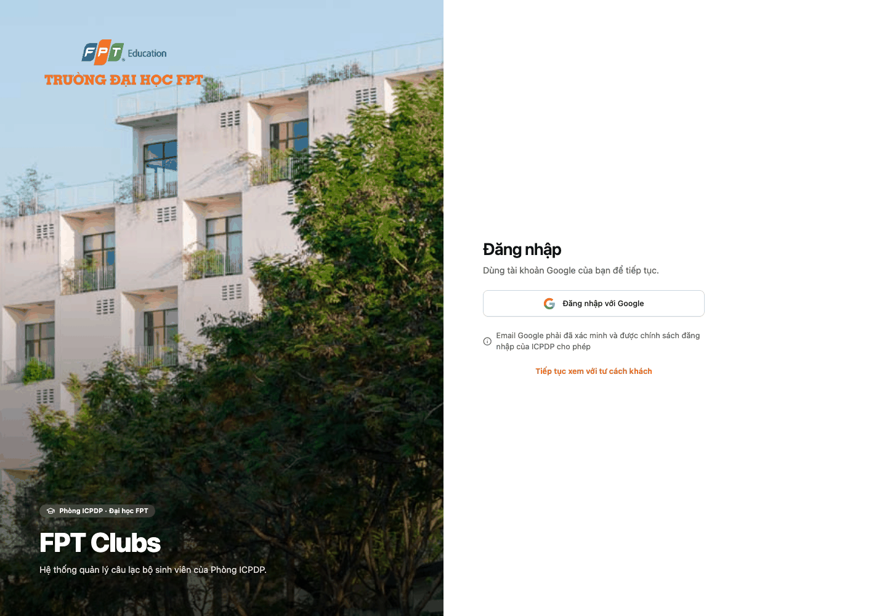

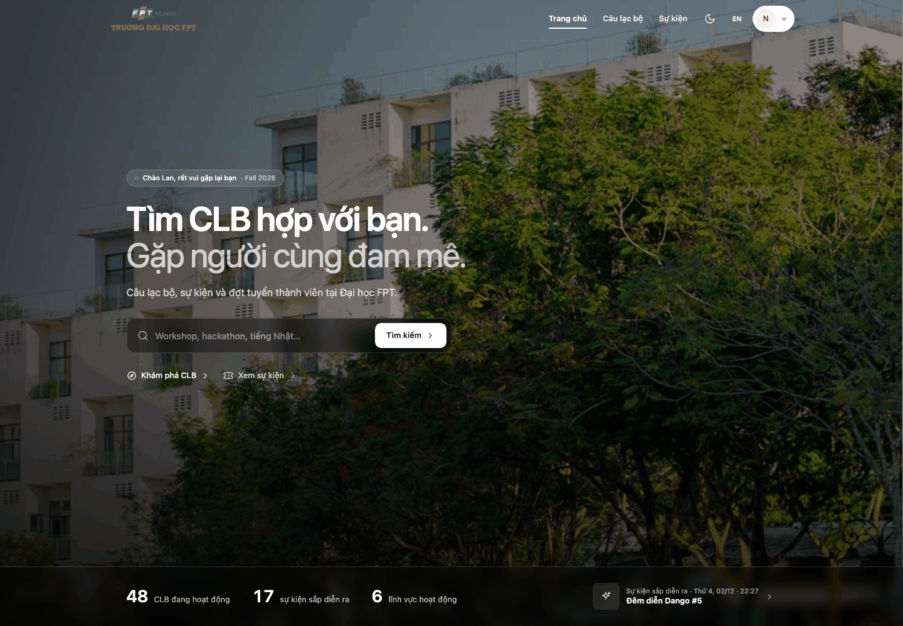

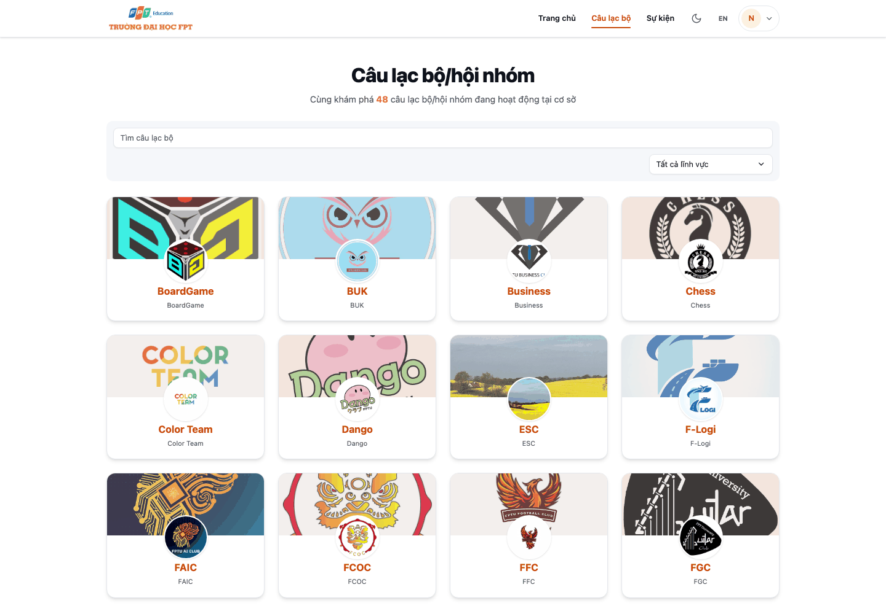

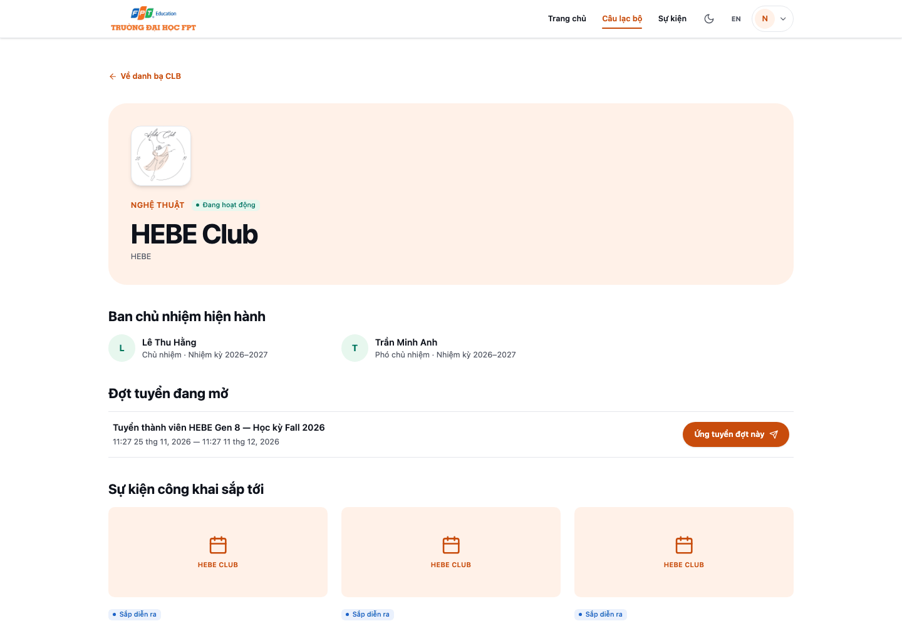

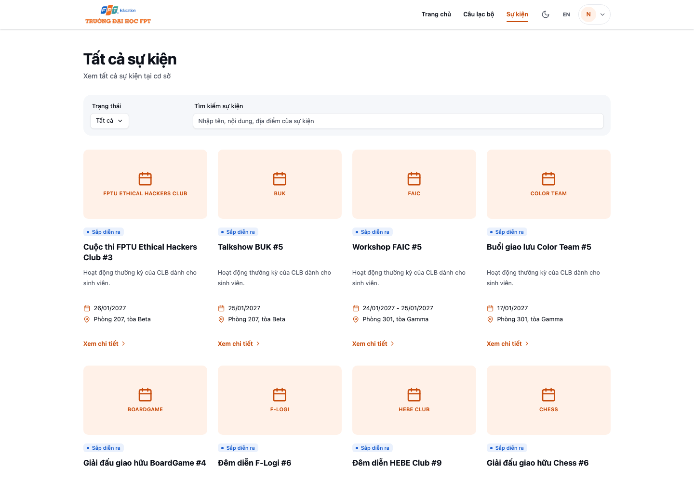

## 2. Chọn không gian làm việc

**Nơi bắt đầu:** `/workspace`.

Màn hình hiện lời chào và một thẻ cho mỗi không gian mà tài khoản có quyền:

- **Sinh viên**: CLB của tôi, sự kiện đã đăng ký, đơn ứng tuyển, thông báo cá nhân.
- **CLB**: mỗi CLB một thẻ. Club Leader (Chủ nhiệm và Phó chủ nhiệm đã xác nhận) thấy tiêu đề
  "Ban chủ nhiệm CLB …", mô tả bắt đầu bằng **Chủ nhiệm**; Club Member thấy tên CLB, mô tả bắt đầu
  bằng **Thành viên**; người đứng đơn của CLB đang thiết lập thấy **Người sáng lập**.
- **ICPDP**: xét duyệt hồ sơ, chính sách và tài khoản.

1. Bấm **Vào workspace** trên thẻ cần dùng. Tài khoản chỉ có một không gian thì app vào
   thẳng, không hiện màn chọn.
2. Muốn đổi không gian, bấm thẻ ở đầu thanh bên (**Đổi không gian**); không cần đăng nhập lại.
3. Thanh trên cùng có nút sáng/tối, nút đổi ngôn ngữ (**EN/VI**) và chuông thông báo. Bấm tên tài
   khoản ở chân thanh bên để mở menu có **Đăng xuất**.

Thanh bên chia nhóm theo không gian:

| Không gian | Nhóm | Mục |
|---|---|---|
| Sinh viên | — | Tổng quan |
| Sinh viên | Câu lạc bộ | CLB của tôi · Ứng tuyển CLB · Thành lập CLB |
| Sinh viên | Sự kiện & góp ý | Sự kiện của tôi · Khiếu nại |
| CLB | Thành viên & tổ chức | Thành viên · Tuyển thành viên · Chuyển giao nhiệm kỳ · Yêu cầu tạm ngừng · Ban chủ nhiệm · Lịch sử ban chủ nhiệm · Thiết lập CLB |
| CLB | Sự kiện | Lời mời sự kiện cấp trường · Sự kiện CLB · Đăng ký & điểm danh · Phản hồi sự kiện · Báo cáo định kỳ · Báo cáo sau sự kiện |
| CLB | Tài chính & cơ sở vật chất | Khoản chi và quyết toán · Phòng được phân · Yêu cầu cơ sở vật chất |
| CLB | — | Tuân thủ và giải trình · Kết quả đánh giá · Khiếu nại · Trang công khai |
| ICPDP | Câu lạc bộ | Quản lý CLB · Duyệt hồ sơ thành lập · Yêu cầu tạm ngừng · Xác nhận ban chủ nhiệm · Duyệt chuyển giao nhiệm kỳ · Lĩnh vực CLB |
| ICPDP | Sự kiện & cơ sở vật chất | Duyệt đề xuất sự kiện · Báo cáo sau sự kiện · Giải ngân kinh phí · Sự kiện cấp trường · Lịch sự kiện · Phân phòng CLB · Yêu cầu cơ sở vật chất · Phòng & thiết bị |
| ICPDP | Đánh giá & báo cáo | Tiêu chí đánh giá CLB · Báo cáo định kỳ · Đánh giá CLB · Hồ sơ vi phạm · Xuất báo cáo |
| ICPDP | — | Khiếu nại · Định tuyến phê duyệt |
| ICPDP | Thiết lập hệ thống | Chính sách nhà trường · Tài khoản & phân quyền |

Sinh viên và CLB còn có phần **Khám phá** (Khám phá CLB, Sự kiện) ở cuối thanh bên.

**Kết quả:** ở không gian CLB, Club Member chỉ thấy Tổng quan, Thành viên (chỉ xem), Đăng ký & điểm
danh, Phòng được phân và Trang công khai; các mục quản lý chỉ hiện với Club Leader (xem chương 4). Thẻ ở đầu thanh bên ghi nhãn
**Chủ nhiệm** cho mọi Club Leader, kể cả Phó chủ nhiệm.

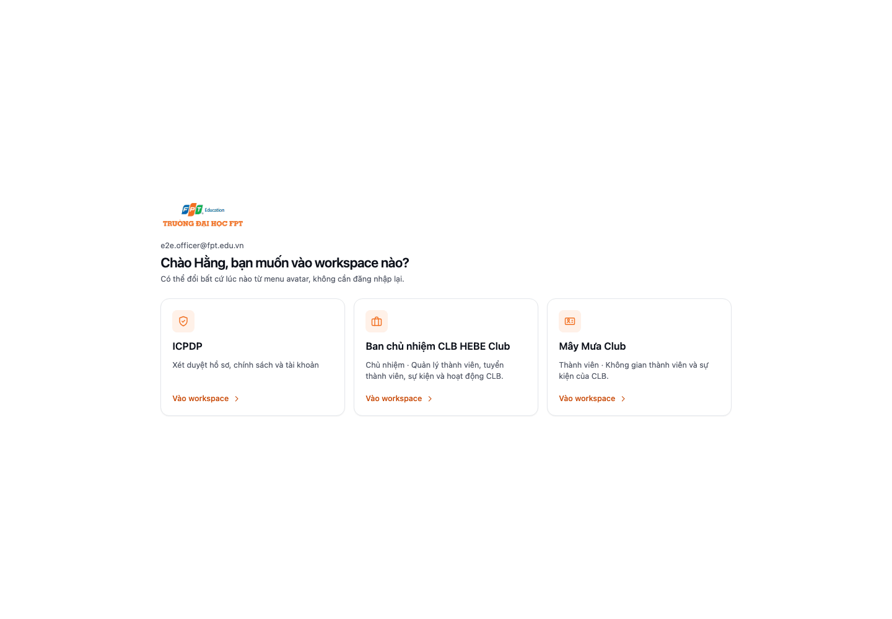

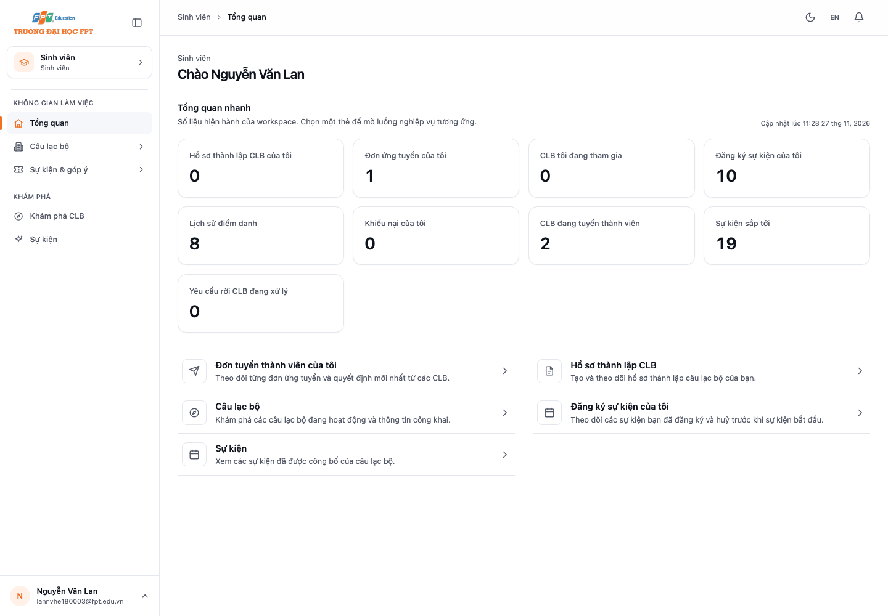

## 3. Nộp hồ sơ thành lập CLB

**Vai trò:** Sinh viên. **Nơi bắt đầu:** **Thành lập CLB** (`/workspace/applications`) → tạo
hồ sơ mới.

1. Bước thông tin CLB: nhập tên, lĩnh vực và các mục mà chính sách nhà trường đang bắt buộc.
2. Bước thành viên sáng lập: thêm tài khoản bằng email và gán vai trò. Cơ cấu cố định là
   1 Chủ nhiệm, 1–2 Phó chủ nhiệm và các thành viên; số người tối thiểu lấy từ chính sách.
3. Tải đề án PDF/DOCX (tối đa 10MB) và logo PNG/JPG (tối đa 2MB).
4. Sang bước kiểm tra; xử lý từng mục còn thiếu trong danh sách cảnh báo.
5. Lưu nháp để làm tiếp sau, hoặc nộp khi hồ sơ đủ điều kiện.
6. Theo dõi trạng thái ở danh sách hồ sơ. Khi bị yêu cầu chỉnh sửa, sửa các phần được yêu cầu
   rồi nộp lại; các bản đã nộp trước vẫn được giữ.

**Kết quả:** hồ sơ chuyển `Draft` → `Submitted`. Khi được duyệt, CLB chuyển sang hoạt động
ngay, ban chủ nhiệm trong hồ sơ được xác lập và không gian CLB xuất hiện ở màn chọn workspace.

**Phía ICPDP:** mở **Duyệt hồ sơ thành lập** (`/workspace/reviews`), bấm **Mở thẩm định** ở hồ
sơ cần xem, nhận thẩm định, xem các phần, lịch sử bản nộp và file đính kèm. Ghi lý do rồi chọn duyệt, yêu cầu chỉnh
sửa hoặc từ chối.

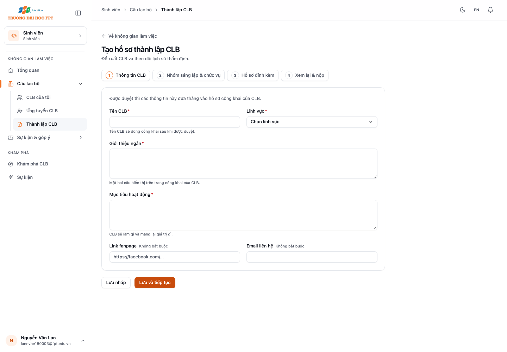

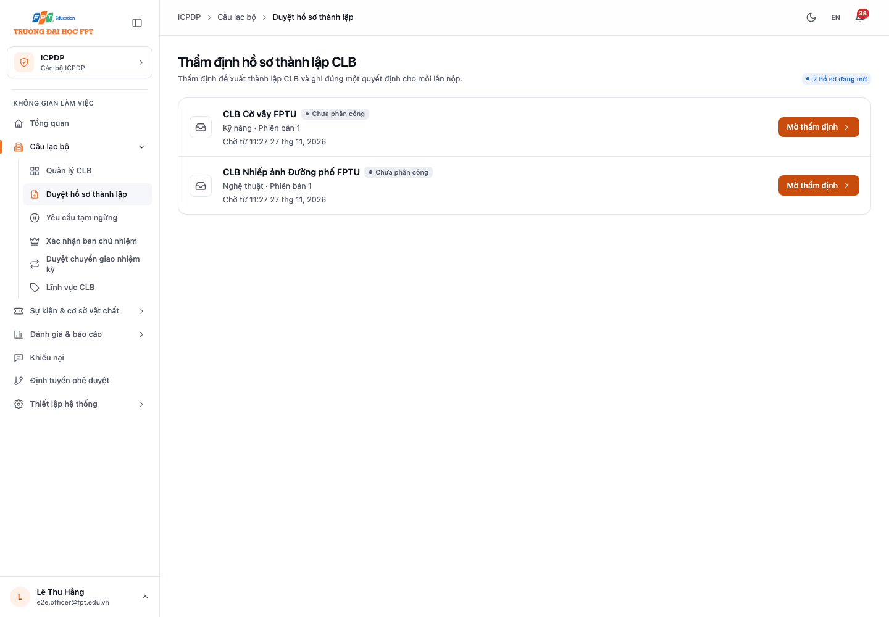

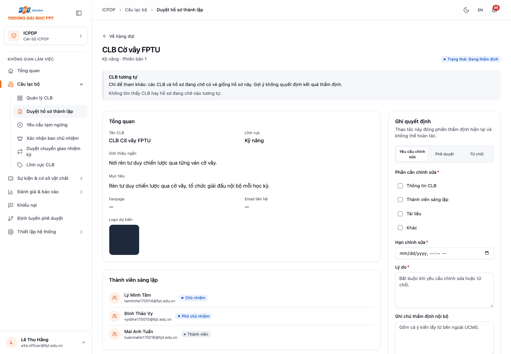

## 4. Thiết lập CLB và hai vai trò trong CLB

Phía CLB chỉ có **hai vai trò cố định** do hệ thống định nghĩa, không tự tạo thêm vai trò hay chia quyền lẻ
(BR47, BR54, BR55):

- **Club Leader**: Chủ nhiệm và các Phó chủ nhiệm đã được ICPDP xác nhận (qua hồ sơ thành lập, đề cử ban
  chủ nhiệm hoặc chuyển giao nhiệm kỳ). Có toàn quyền quản lý CLB; Chủ nhiệm và Phó chủ nhiệm có quyền như
  nhau.
- **Club Member**: mọi thành viên đang hoạt động khác. Xem và tham gia, cộng hai việc mọi thành viên đều
  làm được: **quản lý danh sách chờ / chốt điểm danh** sự kiện và **xem phòng được phân**.

Các chức danh khác trong cơ cấu CLB (Trưởng ban, Thủ quỹ…) chỉ để hiển thị, không cấp thêm quyền.

| Việc | Club Leader | Club Member |
|---|---|---|
| Xem Tổng quan CLB, trang công khai, danh sách thành viên | Có (quản lý được) | Có (chỉ xem) |
| Không gian thành viên, xin rời CLB, đăng ký sự kiện, check-in, phản hồi, khiếu nại | Có | Có |
| Danh sách chờ, điểm danh hộ, chốt điểm danh | Có | Có |
| Xem phòng được phân | Có | Có |
| Sửa hồ sơ vận hành và cơ cấu ban/bộ phận (Thiết lập CLB) | Có | Không |
| Đổi trạng thái thành viên, xử lý yêu cầu rời, xuất Excel | Có | Không |
| Tạo đợt tuyển, xét đơn, chấm rubric, tiếp nhận thành viên | Có | Không |
| Đề cử ban chủ nhiệm, lập kế hoạch chuyển giao, xin tạm ngừng | Có | Không |
| Đề xuất, công bố, đổi lịch, huỷ sự kiện; quản lý sức chứa | Có | Không |
| Xem phản hồi sự kiện, trả lời khiếu nại được chuyển xuống | Có | Không |
| Báo cáo sau sự kiện, báo cáo định kỳ, ghi khoản chi, nộp quyết toán | Có | Không |
| Gửi yêu cầu cơ sở vật chất | Có | Không |

Thành viên muốn có quyền quản lý thì phải được đề cử vào ghế Phó chủ nhiệm và được ICPDP xác nhận
(chương 5).

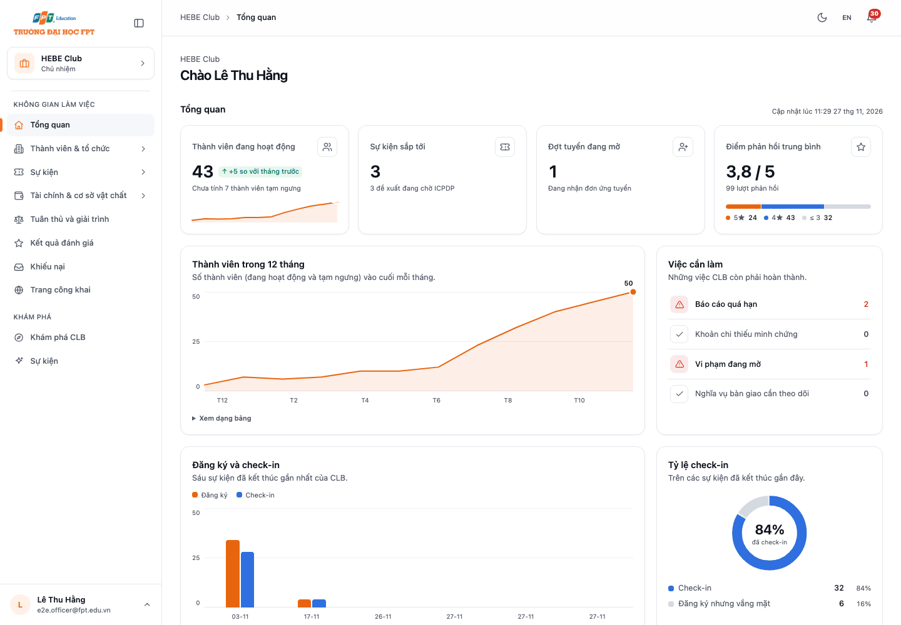

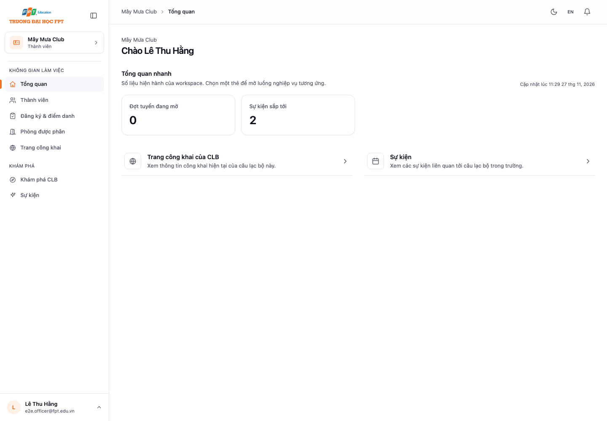

### Thiết lập hồ sơ và cơ cấu

**Vai trò:** Club Leader. **Nơi bắt đầu:** **Thiết lập CLB** (`/club/:clubId/settings`).

1. Phần **Định danh do nhà trường quản lý** (mã CLB, tên, lĩnh vực, trạng thái) chỉ để xem.
2. Ở **Hồ sơ vận hành**, nhập mô tả, phạm vi hoạt động, email, số điện thoại, URL điều lệ.
   Dùng **Thêm kênh** để khai báo kênh công khai (tên kênh, URL). Bấm **Lưu hồ sơ**.
3. Ở **Cơ cấu nội bộ**, chọn **Dùng cơ cấu khởi đầu** (khi chưa có bộ phận nào) hoặc
   **Thêm bộ phận** (tên, mô tả, thứ tự hiển thị) rồi **Lưu bộ phận**. Mỗi bộ phận có **Sửa**
   và **Ngừng dùng**.

**Kết quả:** các mục có dấu * là bắt buộc theo chính sách nhà trường. Ban/bộ phận chỉ để mô tả
cơ cấu, không gắn quyền.

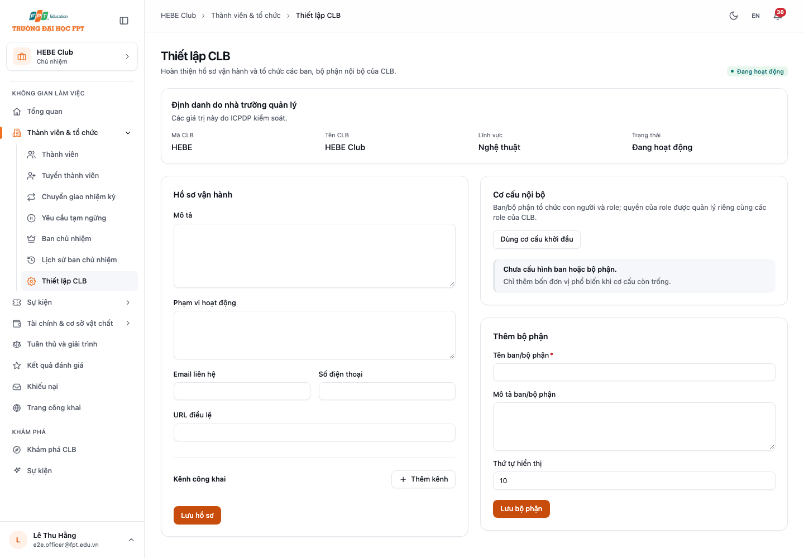

## 5. Ban chủ nhiệm và chuyển giao nhiệm kỳ

### CLB đề cử ban chủ nhiệm

**Vai trò:** Club Leader. **Nơi bắt đầu:** **Ban chủ nhiệm**
(`/club/:clubId/board`).

1. Xem **Nhiệm kỳ hiện tại** (ngày bắt đầu, kết thúc).
2. Ở **Ghế ban điều hành còn trống**, với từng ghế (kể cả ghế Chủ nhiệm) chọn một thành viên
   đang hoạt động.
3. Bấm **Nộp đề cử**. App báo "Đã gửi đề cử đến ICPDP."

**Kết quả:** phải chọn ít nhất một ghế. App chặn người có nhiệm kỳ Chủ nhiệm bị chồng lấn.
Quyền của người được đề cử chỉ có hiệu lực sau khi ICPDP xác nhận.

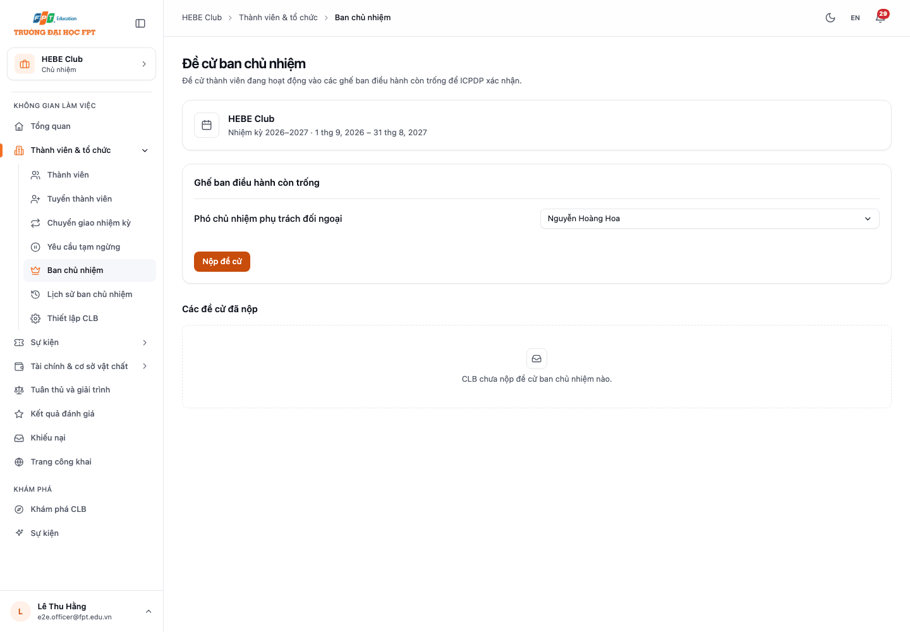

### ICPDP xác nhận ban chủ nhiệm

**Nơi bắt đầu:** **Xác nhận ban chủ nhiệm** (`/workspace/board-nominations`).

1. Ở hàng đợi, bấm **Xem đề cử**, rồi **Nhận quyết định**.
2. Với từng ghế, chọn **Xác nhận ghế** hoặc **Trả ghế** (bắt buộc nhập lý do trả ghế).
3. Nhập **Ghi chú quyết định**, bấm **Ghi một quyết định** và xác nhận.

**Kết quả:** ghế chuyển sang Đã xác nhận hoặc Đã trả để đề cử lại. Mỗi đề cử chỉ nhận một
quyết định; trả lại tất cả các ghế thì bắt buộc có ghi chú. Nếu officer khác đã nhận, app báo
và không cho thao tác trùng.

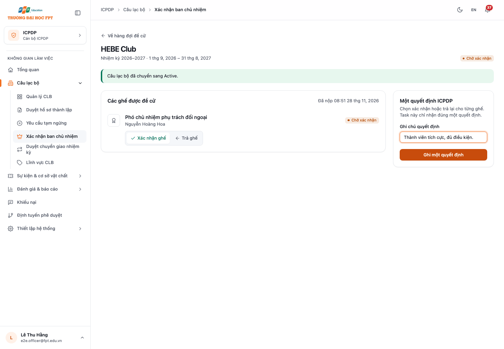

### ICPDP duyệt chuyển giao nhiệm kỳ

**Nơi bắt đầu:** **Duyệt chuyển giao nhiệm kỳ** (`/workspace/leadership-transitions`).

1. Bấm **Thẩm định chuyển giao**; đọc các phần bàn giao, ban điều hành mới, nghĩa vụ còn
   tồn đọng, danh mục bàn giao và cơ cấu đề xuất.
2. Bấm **Nhận xử lý**.
3. Chọn **Phê duyệt chuyển giao** hoặc **Trả lại để chỉnh sửa** (bắt buộc lý do), nhập ghi
   chú và bấm **Gửi quyết định**.

**Kết quả:** khi phê duyệt, nhiệm kỳ cũ đóng, nhiệm kỳ mới có hiệu lực và quyền được cấp lại.
Không phê duyệt được khi CLB đang tạm ngừng.

**Phía CLB:** Club Leader lập và nộp kế hoạch ở **Chuyển giao nhiệm kỳ**
(`/club/:clubId/transition-plans`): tên nhiệm kỳ mới, ngày dự kiến chuyển giao, ngày kết thúc nhiệm
kỳ mới, lý do nếu chuyển giao sớm, Chủ nhiệm và Phó chủ nhiệm kế nhiệm, rồi giao từng nghĩa vụ còn
tồn đọng (sự kiện, báo cáo…) cho một thành viên phụ trách.

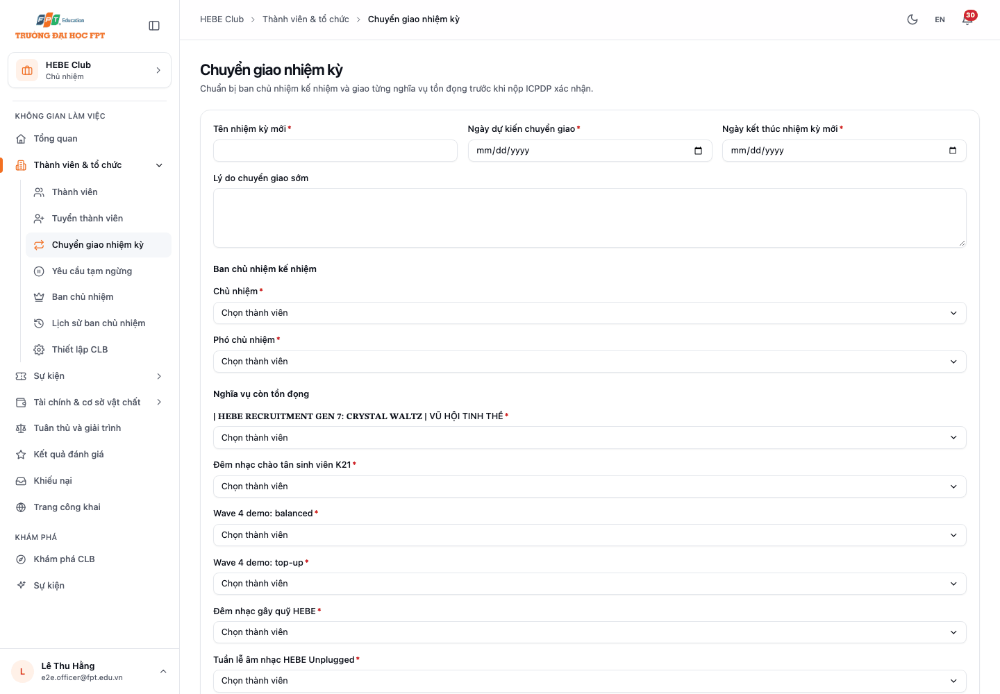

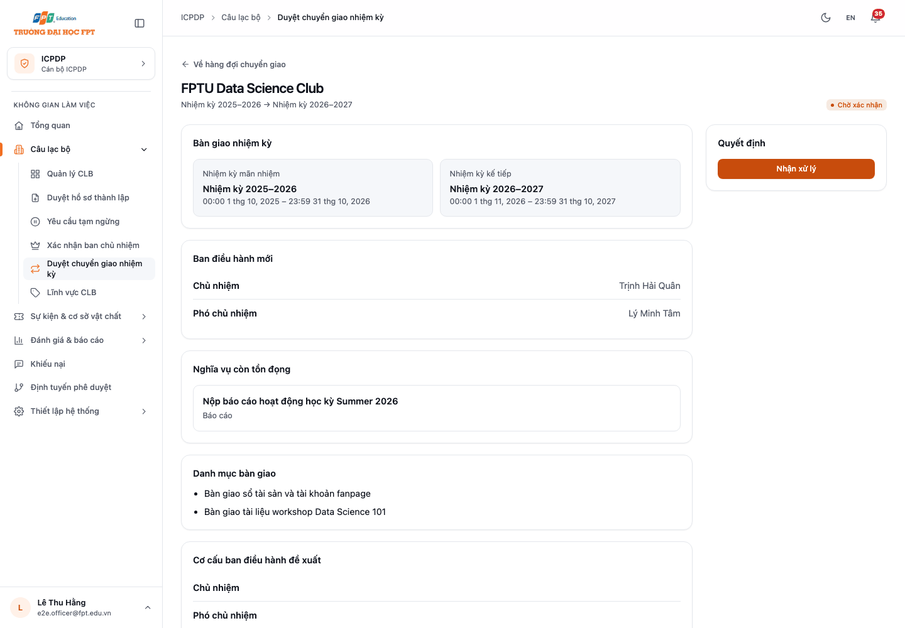

## 6. Tuyển thành viên

**Vai trò:** Club Leader tạo đợt tuyển và xét đơn; Sinh viên ứng tuyển.

1. CLB mở **Tuyển thành viên** (`/club/:clubId/recruitment`), tạo đợt tuyển: tên, vị trí,
   tiêu chí, thời gian nhận đơn, chỉ tiêu, câu hỏi ứng tuyển và rubric đánh giá.
2. Lưu nháp rồi công bố. Chỉ CLB đang hoạt động mới mở được đợt tuyển mới.
3. Sinh viên mở **Ứng tuyển CLB** (`/workspace/recruitment`) hoặc trang chi tiết CLB, chọn
   đợt tuyển, điền câu trả lời và nộp; có thể rút đơn khi còn cho phép.
4. CLB mở trang xét đơn của đợt (`/club/:clubId/recruitment/:campaignId/review`), đọc đơn,
   chấm theo rubric và ghi nhận xét phỏng vấn.
5. Ra quyết định nhận, từ chối hoặc đưa vào danh sách chờ, kèm lý do.
6. Với ứng viên được nhận, thực hiện tiếp nhận để tạo tư cách thành viên. Kiểm tra trạng thái
   `Onboarded`; `Accepted` chưa có nghĩa là đã thành thành viên.

**Kết quả:** sinh viên theo dõi quyết định trong **Ứng tuyển CLB**. Đợt tuyển của CLB đang
tạm ngừng vẫn hiện nhưng không nhận đơn mới.

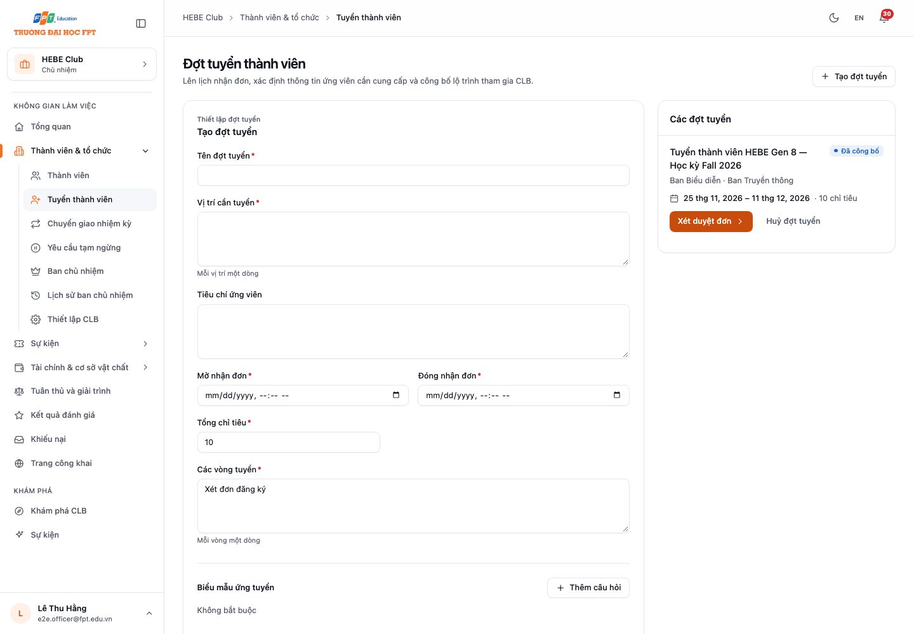

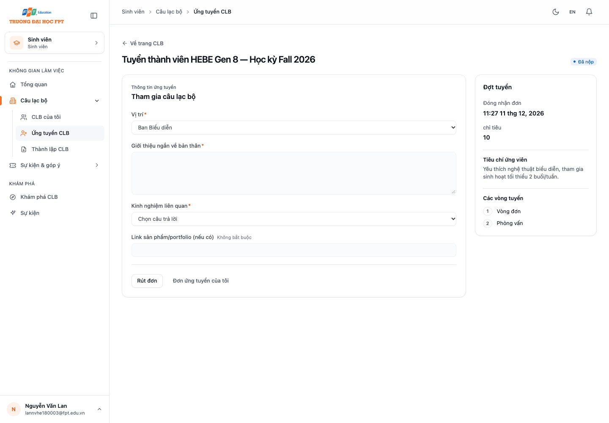

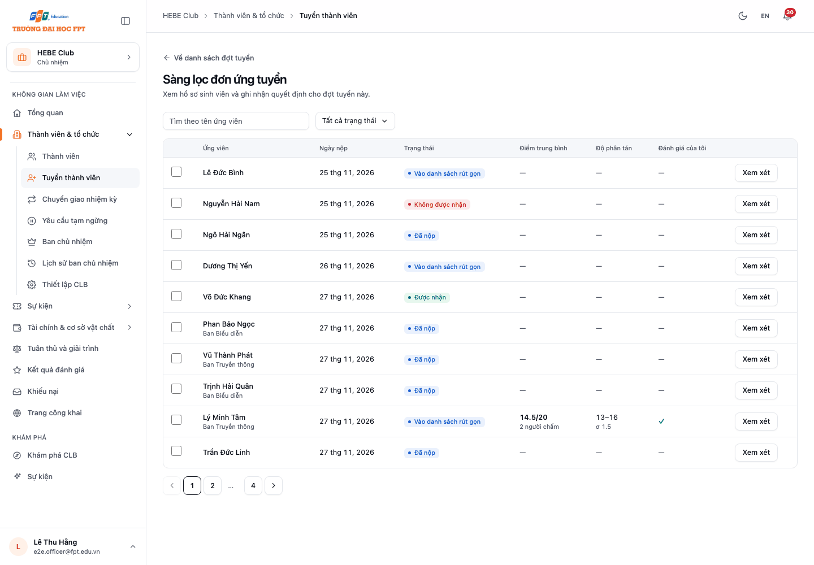

## 7. Thành viên và yêu cầu rời CLB

**Nơi bắt đầu:** CLB → **Thành viên** (`/club/:clubId/members`); Sinh viên → **CLB của tôi**
(`/workspace/clubs`).

1. Club Member chỉ thấy danh sách thành viên. Club Leader thấy bảng quản lý: tìm theo tên/email,
   lọc trạng thái hoặc chức vụ.
2. Chọn **Đổi trạng thái**, nhập lý do khi được yêu cầu và xác nhận. Loại thành viên bắt buộc
   có lý do.
3. Xem lịch sử trạng thái; dùng **Xuất Excel** khi cần danh sách.
4. Sinh viên mở một CLB trong **CLB của tôi** để vào không gian thành viên: ban chủ nhiệm,
   hoạt động và thông tin thành viên.
5. Muốn rời CLB, tạo yêu cầu rời, ghi lý do và ngày có hiệu lực.

**Kết quả:** trạng thái và lịch sử được cập nhật. Yêu cầu rời đang chờ chưa có nghĩa là đã
rời CLB.

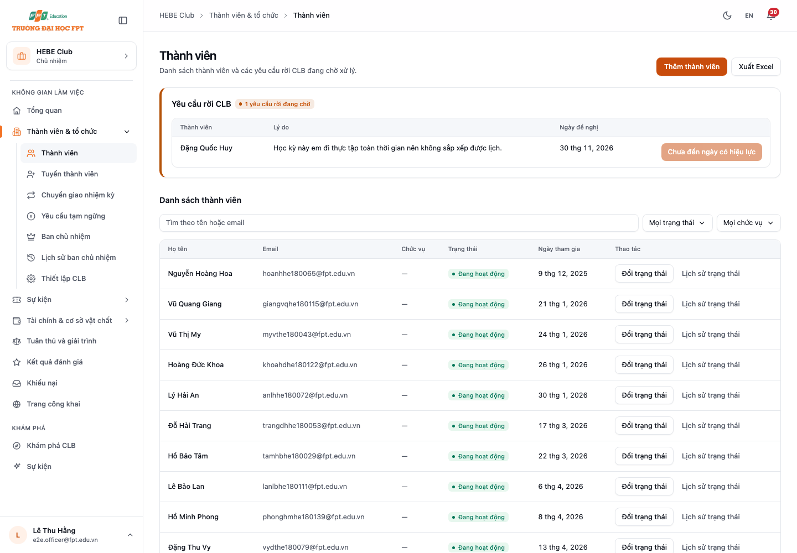

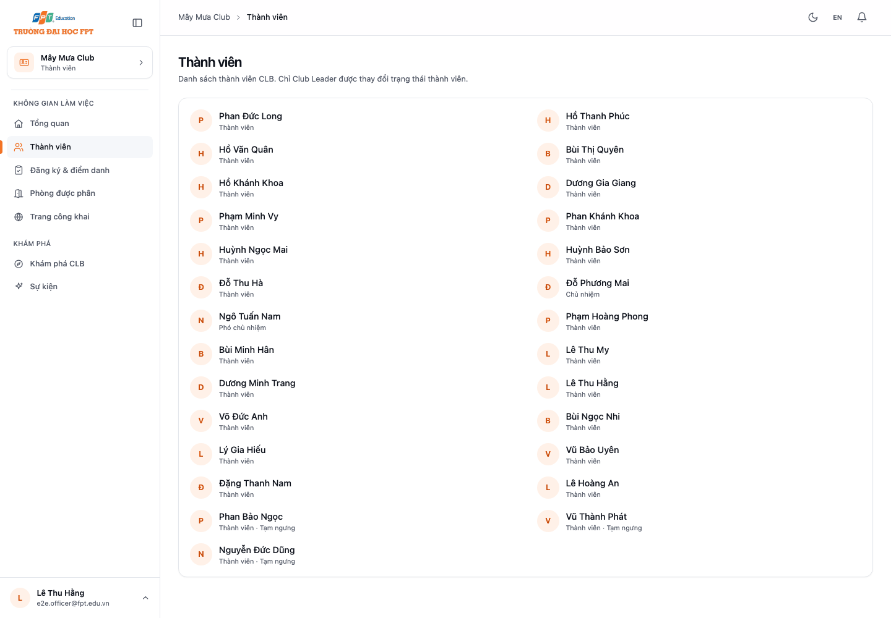

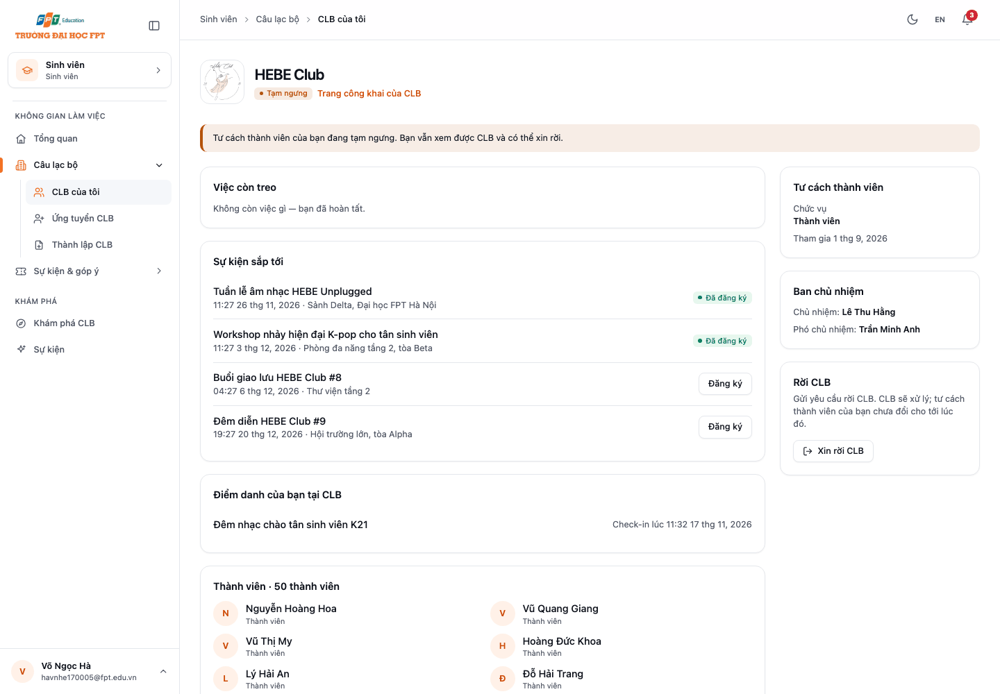

## 8. Sự kiện CLB

**Vai trò:** Club Leader; ICPDP thẩm định. **Nơi bắt đầu:**
**Sự kiện CLB** (`/club/:clubId/events`).

### Đề xuất và thẩm định

1. Bấm **Tạo đề xuất sự kiện** (mở trang `/club/:clubId/events/new`). Ở khung **File mẫu đề án của
   ICPDP**, bấm **Tải file mẫu đề án** và điền file Word: bảng Tổng quan (tên sự kiện, mục đích, nội
   dung, ngày và giờ bắt đầu/kết thúc `dd/mm/yyyy HH:mm`, địa điểm, đối tượng, số người tham gia, mức
   độ rủi ro Thấp / Trung bình / Cao) và bảng đề xuất kinh phí xin trường theo hạng mục.
2. Bấm **Import đề án** và chọn file `.docx` (tối đa 10 MB; chưa đọc được PDF hay ảnh scan). App tự
   đọc file, hiện **Bản xem đề án** và các thông tin trích xuất; các ô này chỉ để xem, muốn sửa thì
   sửa file Word rồi import lại.
3. Bấm **Lưu bản nháp** hoặc **Lưu & nộp đề xuất**. Phải nộp trước ngày diễn ra ít nhất 7 ngày; app
   kiểm tra trùng lịch và chặn nộp khi CLB còn nghĩa vụ quá hạn (báo cáo, quyết toán). Rời trang khi
   chưa lưu thì app hỏi **Bỏ thay đổi?** trước khi đi.
4. ICPDP mở **Duyệt đề xuất sự kiện** (`/workspace/event-proposals`; tab **Chờ xử lý** và **Đã
   duyệt**), bấm **Mở** để nhận thẩm định, xem hoặc tải file đề án, đối chiếu lịch, nghĩa vụ CLB và
   từng dòng ngân sách. Với mỗi hạng mục kinh phí, chọn **Quyết định tài trợ**: **Không tài trợ**,
   **Tài trợ · Trả trước** hoặc **Tài trợ · Trả sau** (chương 16). Rồi duyệt, yêu cầu chỉnh sửa hoặc
   từ chối kèm lý do. Cán bộ ICPDP cũng thay được file mẫu đề án ngay trên trang hàng đợi
   (**Thay thế mẫu mới**).
5. Khi ở trạng thái **Yêu cầu chỉnh sửa**, CLB chọn **Sửa đề xuất**, import lại file đã sửa rồi
   nộp lại. Bản cũ vẫn được giữ.

**Kết quả:** duyệt đề xuất thì app tạo ngân sách sự kiện, mỗi hạng mục được tài trợ thành một hạng
mục giải ngân. Đề xuất
quá hạn mà chưa được xử lý sẽ tự chuyển **Hết hạn**.

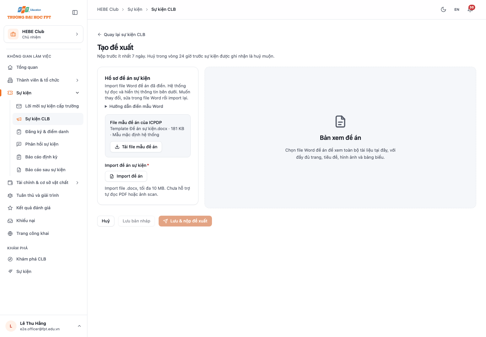

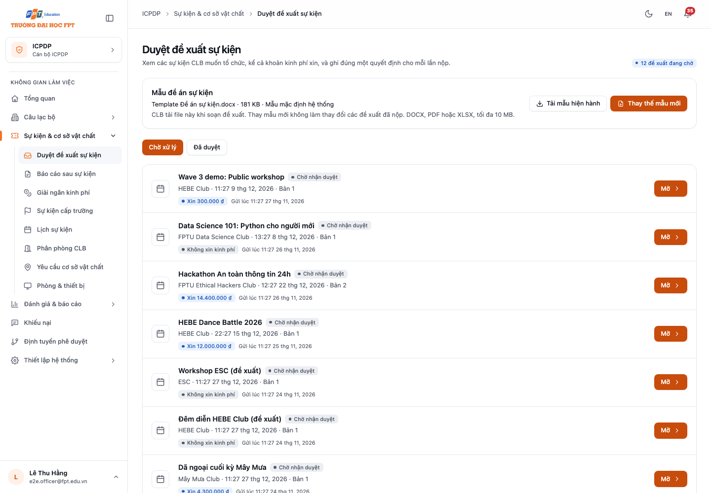

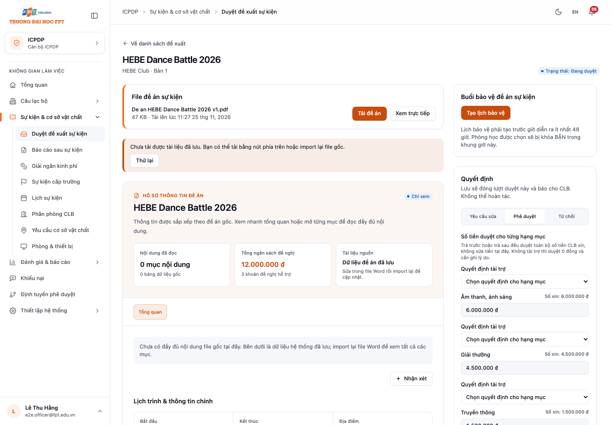

### Buổi bảo vệ đề xuất (BR63)

ICPDP có thể yêu cầu CLB bảo vệ trực tiếp một đề xuất trước khi quyết định. **Vai trò:** cán bộ
ICPDP phụ trách đề xuất (người đã nhận thẩm định) xếp lịch và điều khiển buổi bảo vệ; Club Leader
xác nhận hoặc xin dời lịch.

1. **ICPDP xếp lịch.** Ở trang thẩm định đề xuất (`/workspace/event-proposals/:id`), khung
   **Buổi bảo vệ đề án sự kiện** cạnh bảng quyết định, bấm **Tạo lịch bảo vệ**: nhập tiêu đề,
   thời gian bắt đầu, thời lượng (15–240 phút), chọn phòng học cơ sở (phòng `ROOM` đang hoạt
   động; phòng bận hiện nhãn **BẬN**) và ghi chú. Lịch phải tạo trước giờ bảo vệ ít nhất 48 giờ;
   phòng bị khoá trong khung giờ đó.
2. Khi còn lịch bảo vệ hiệu lực, nút **Phê duyệt**, **Từ chối** và **Bảo vệ lại** tạm khoá. Cán bộ
   vẫn **Yêu cầu sửa** được, với hạn nộp bản sửa trước giờ bảo vệ ít nhất 12 giờ, hoặc
   **Hủy lịch bảo vệ** kèm lý do để mở lại các nút quyết định.
3. **Club Leader xác nhận.** Ở **Sự kiện CLB** (`/club/:clubId/events`), thẻ **Lịch hẹn bảo vệ đề
   án với ICPDP** hiện thời gian, thời lượng, phòng và ghi chú. Bấm **Xác nhận tham gia**, hoặc
   **Đề xuất dời lịch** kèm lý do; cả hai phải làm trước giờ bảo vệ ít nhất 24 giờ. Quá hạn mà chưa
   xác nhận thì cán bộ ICPDP thấy cảnh báo.
4. **ICPDP xử lý xin dời lịch:** **Chấp nhận & chọn lịch mới**, hoặc **Từ chối dời lịch (giữ lịch
   cũ)** kèm lý do. Khi chấp nhận, giờ mới chỉ cần ở tương lai (mốc 48 giờ chỉ áp cho lần xếp lịch
   đầu) và lịch mới được coi là **đã xác nhận** ngay, vì chính CLB đề xuất giờ đó; CLB không phải xác
   nhận lại. Từ chối thì lịch quay về trạng thái trước khi xin dời.
5. **Phòng bảo vệ trực tiếp.** Đến giờ (sớm nhất 30 phút trước giờ hẹn), cán bộ phụ trách bấm
   **Bắt đầu bảo vệ**; app mở **Phòng bảo vệ đề án trực tiếp**
   (`/workspace/event-proposals/:id/defense`). Cột trái là thông tin đề án và ngân sách; cột phải
   là biên bản ghi chú Markdown, mỗi cán bộ một tab **Ghi chú của tôi** tự lưu mỗi 2 giây, tab
   **Ghi chú hội đồng** xem ghi chú của mọi người. Cán bộ khác vào bằng **Vào phòng bảo vệ**. Chỉ cán
   bộ phụ trách bấm được **Kết thúc bảo vệ**.
6. **Quyết định sau bảo vệ:** quay lại trang thẩm định, khung **Quyết định sau bảo vệ** cho chọn
   một trong bốn kết quả — **Phê duyệt** (nếu có ngân sách thì nhập số tiền duyệt từng hạng mục,
   giảm phải có lý do), **Từ chối**, **Yêu cầu sửa** hoặc **Bảo vệ lại** (đề xuất chuyển **Chờ bảo vệ lại**, ICPDP tạo lịch mới; không giới hạn số lần).
7. **CLB vắng mặt:** cán bộ bấm **Đánh dấu vắng mặt (No-show)** kèm ghi chú → đề xuất bị
   **Từ chối** ngay và phòng được giải phóng.

**Kết quả:** mỗi buổi bảo vệ được lưu trong **Lịch sử các buổi bảo vệ** kèm ghi chú của mọi cán bộ.
Nếu CLB không nộp bản sửa trước hạn (trước giờ bảo vệ 12 giờ), đề xuất **Hết hạn** và lịch bảo vệ tự
huỷ. CLB bị tạm ngừng thì các lịch bảo vệ chưa diễn ra cũng bị huỷ.

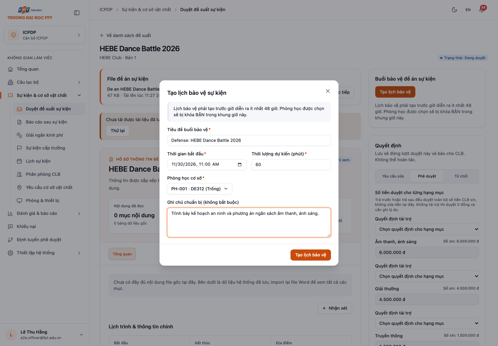

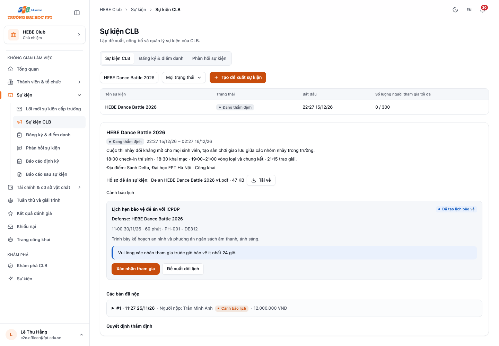

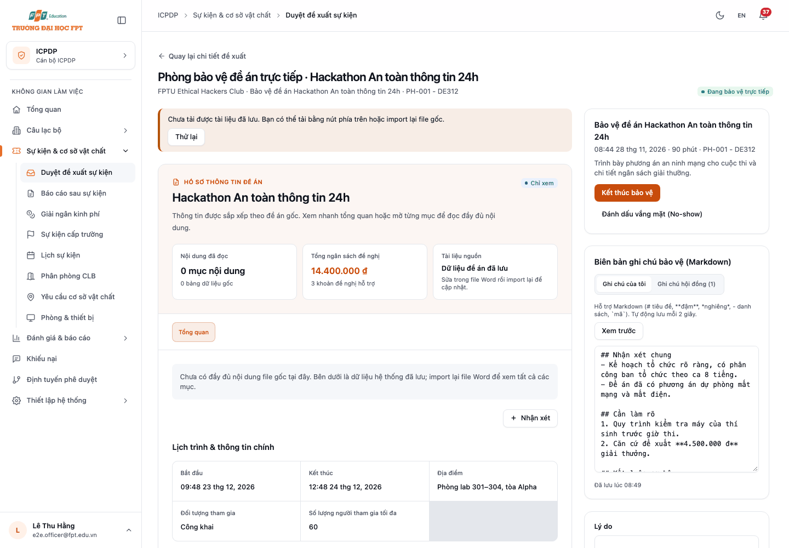

### Công bố, sức chứa, đổi lịch và huỷ

1. Sự kiện **Đã duyệt**: bấm **Công bố**, đặt thời gian mở/đóng đăng ký và check-in, chọn
   **Cho phép khách vãng lai**, **Bật danh sách chờ** hoặc **Không cần đăng ký**.
2. Sự kiện **Sắp diễn ra**: dùng **Sức chứa** để điều chỉnh số chỗ; ở bảng đăng ký có
   **Đẩy người đầu danh sách chờ lên**.
3. **Đổi lịch** (khi Đã duyệt hoặc Sắp diễn ra) và **Huỷ sự kiện** (khi Đã duyệt, Sắp diễn ra
   hoặc Đang diễn ra và chưa chốt điểm danh) đều bắt buộc nhập lý do rồi **Xác nhận**.

**Kết quả:** sự kiện tự chuyển Sắp diễn ra → Đang diễn ra → Đã kết thúc theo thời gian.
Huỷ trong vòng 24 giờ trước sự kiện được ghi nhận là huỷ muộn. Người đã đăng ký nhận thông
báo khi sự kiện đổi lịch hoặc bị huỷ.

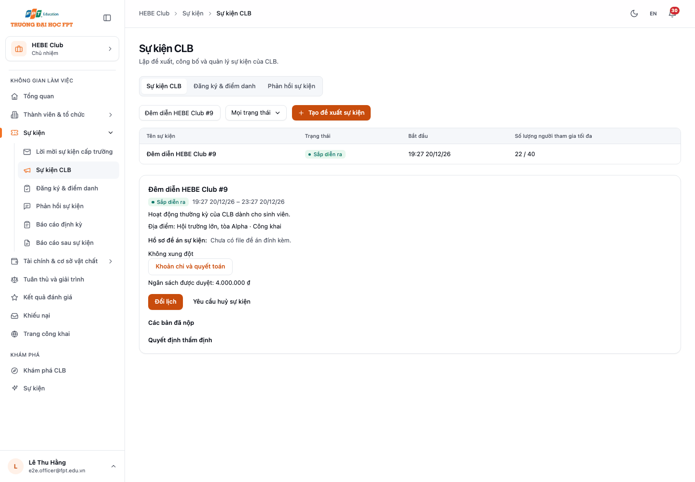

## 9. Sự kiện cấp trường

**Vai trò:** ICPDP. **Nơi bắt đầu:** **Sự kiện cấp trường** (`/workspace/school-events`).

1. Bấm **Tạo sự kiện cấp trường**. Nhập tên, mục tiêu, yêu cầu phối hợp với CLB, thời gian
   bắt đầu/kết thúc, địa điểm (**Phòng trong danh mục** hoặc **Nơi khác**) và số chỗ cho
   sinh viên.
2. Ở **Mời CLB**, chọn **Tất cả CLB đang hoạt động** hoặc **Chọn CLB**. Đặt **Hạn CLB phản
   hồi**; để trống thì hạn là 3 ngày trước khi sự kiện bắt đầu.
3. Bấm **Tạo sự kiện**. Nếu phòng trùng lịch, app chỉ cảnh báo, vẫn cho tạo.
4. Ở trang chi tiết, theo dõi **Phản hồi của CLB** (Chưa trả lời / Nhận lời / Từ chối / Quá
   hạn / Đã thu hồi). Dùng **Thu hồi** cho lời mời đang chờ, hoặc **Mời thêm CLB** →
   **Gửi lời mời**.
5. Bấm **Công bố cho sinh viên** khi sự kiện đang **Chưa công bố**. App mở đăng ký từ lúc
   công bố đến lúc bắt đầu và hiện **Mã check-in**.

**Kết quả:** sự kiện xuất hiện trong lịch sự kiện với đơn vị tổ chức ICPDP; sinh viên đăng
ký, check-in và phản hồi như sự kiện CLB. CLB nhận hoặc từ chối (kèm lý do) ở
mục **Lời mời sự kiện cấp trường** (`/club/:clubId/invitations`): nhập người đại diện, số người dự
kiến tham gia và nội dung phản hồi, rồi bấm **Nhận lời** hoặc **Từ chối** trước hạn phản hồi.

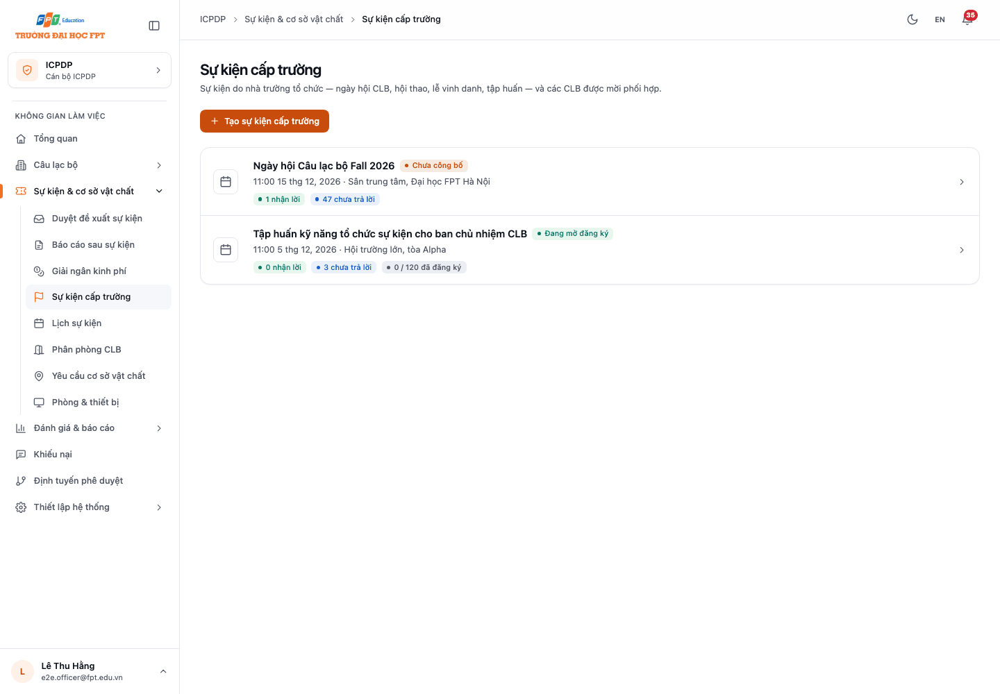

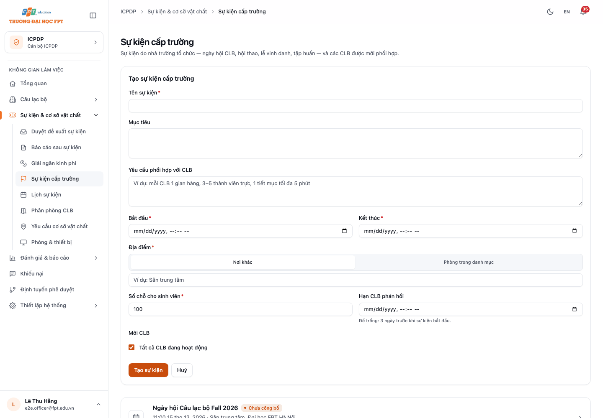

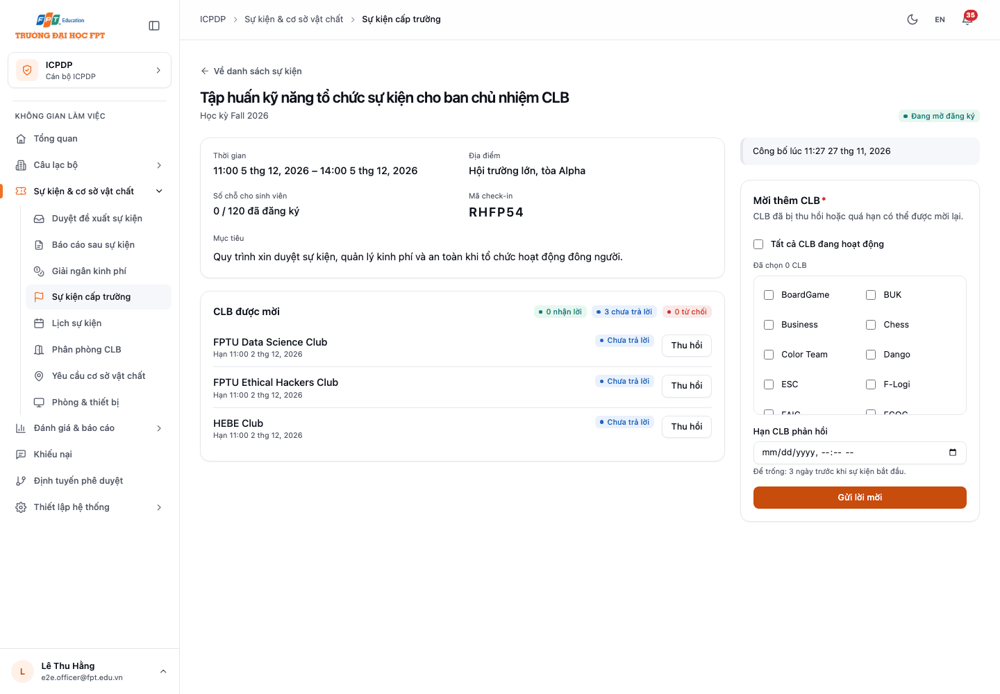

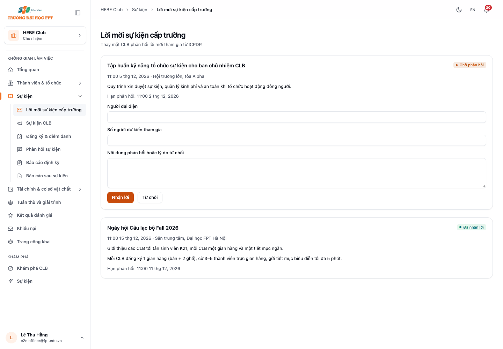

## 10. Đăng ký sự kiện, check-in và gửi phản hồi

**Vai trò:** Sinh viên. **Nơi bắt đầu:** trang sự kiện `/events/:id`; **Sự kiện của tôi**
(`/workspace/event-registrations`).

1. Ở khung **Đăng ký tham gia** trên trang sự kiện, điền biểu mẫu và bấm **Đăng ký**. Khi hết
   chỗ và sự kiện có danh sách chờ, nút đổi thành **Vào danh sách chờ**.
2. Mở **Sự kiện của tôi**, xem các tab Đang hiệu lực / Đã check-in / Đã huỷ. Trạng thái
   "Đang chờ · vị trí n" chưa đảm bảo có chỗ.
3. Trong khung giờ check-in, bấm **Check-in**, nhập **Mã check-in** do ban tổ chức cung cấp
   (hoặc quét QR) và xác nhận.
4. Sau khi check-in, bấm **Gửi phản hồi**: chọn số sao, viết nhận xét, có thể **Gửi ẩn
   danh**, rồi gửi.
5. Không tham dự được thì **Huỷ đăng ký** trước khi sự kiện bắt đầu.

**Kết quả:** đăng ký, check-in và phản hồi là ba bước riêng. Chỉ người đã check-in mới gửi
được phản hồi, trước hạn "Phản hồi mở đến …", và không sửa được sau khi gửi. Sự kiện dành
cho thành viên CLB thì người ngoài không đăng ký được.

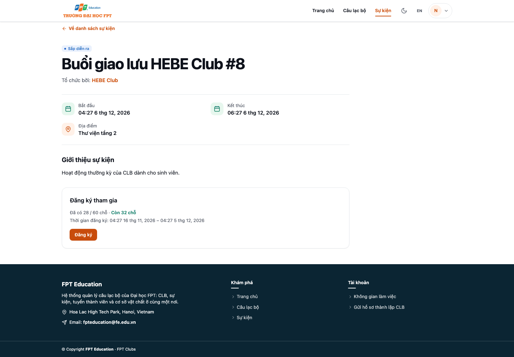

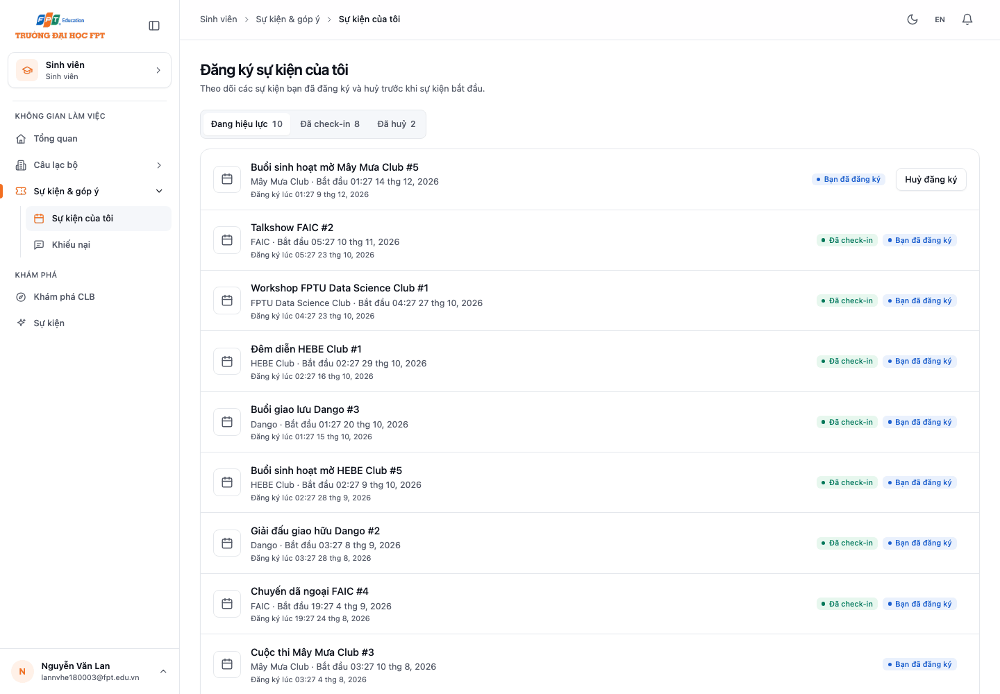

## 11. Chốt điểm danh và xem phản hồi

**Vai trò:** Club Leader.

1. Mở **Đăng ký & điểm danh** (`/club/:clubId/event-attendance`), chọn sự kiện.
2. Đối chiếu danh sách đăng ký với dữ liệu check-in; dùng **Điểm danh hộ** khi người tham dự
   không tự check-in được, ghi lý do khi sửa.
3. Khi sự kiện **Đã kết thúc**, bấm **Chốt điểm danh** và **Xác nhận / hiệu chỉnh**.
4. Mở **Phản hồi sự kiện** (`/club/:clubId/event-feedback`), chọn sự kiện để xem số phản hồi,
   điểm trung bình, phân bố và nhận xét.

**Kết quả:** điểm danh đã chốt bị khoá và trở thành đầu vào báo cáo. Khi chưa đủ số phản hồi
tối thiểu theo chính sách, phần tổng hợp được ẩn. CLB không sửa hay xoá được phản hồi.

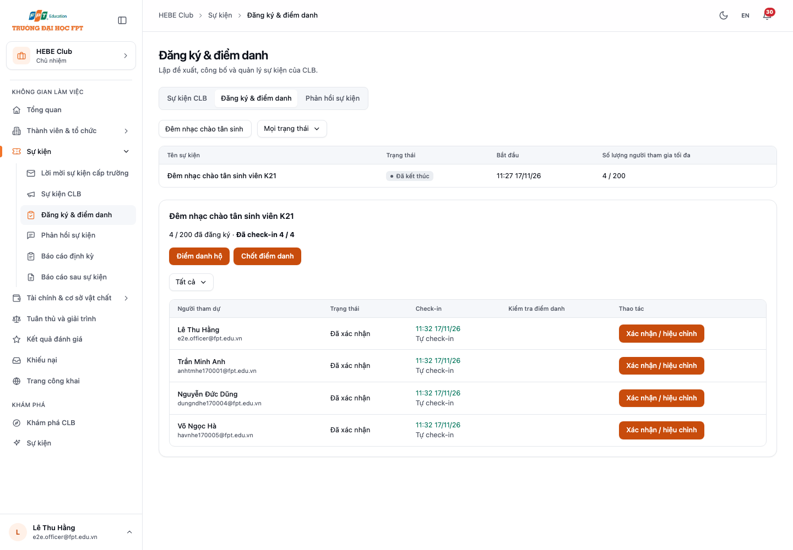

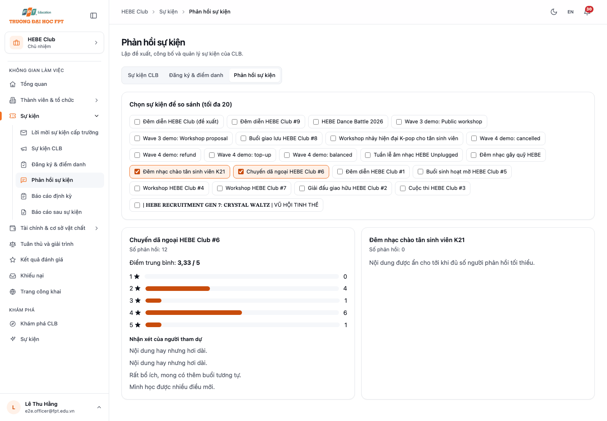

## 12. Cơ sở vật chất

Phòng học không do CLB tự đặt: ICPDP phân phòng cho CLB theo học kỳ. CLB chỉ gửi yêu cầu cho
hội trường, sân trường, sân khấu và thiết bị.

### 12.1. ICPDP quản lý danh mục

**Nơi bắt đầu:** **Phòng & thiết bị** (`/workspace/properties`).

1. Bấm **Thêm cơ sở vật chất**, chọn loại: Phòng / Hội trường / Sân trường / Sân khấu / Thiết
   bị. Mã được sinh tự động.
2. Nhập tên, vị trí, sức chứa và thiết bị đi kèm.
3. Đặt **Khung giờ được đặt** cho T2–CN (một khung chung hoặc mỗi ngày một khung).
4. Dùng **Thêm giai đoạn khoá** cho thời gian bảo trì (bắt buộc lý do).
5. Bấm **Tạo cơ sở vật chất**. Mỗi mục có **Sửa**, **Ngừng sử dụng**, **Dùng lại**, **Xoá**.

**Kết quả:** mục đã từng được đặt chỉ ngừng sử dụng được, không xoá được.

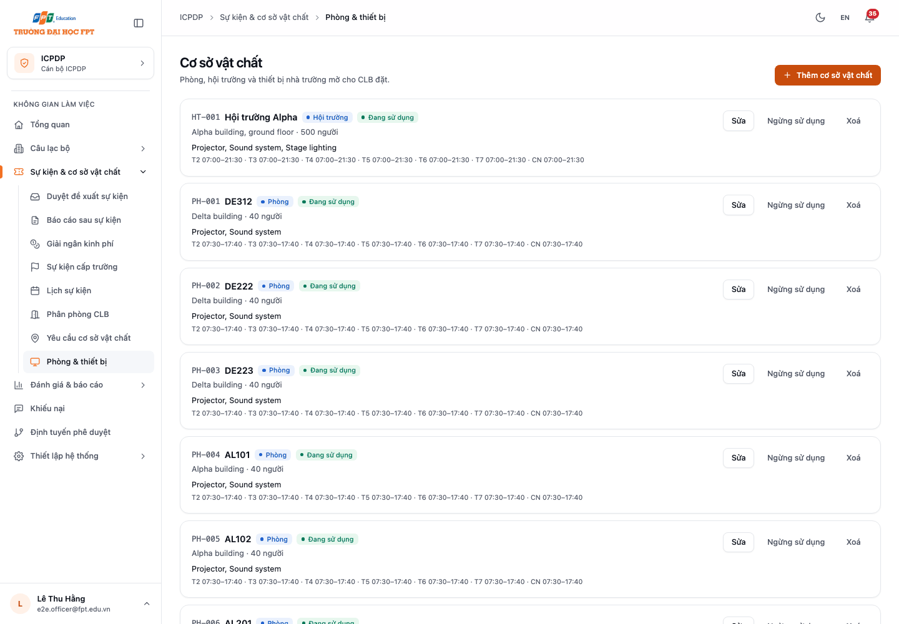

### 12.2. ICPDP phân phòng học theo học kỳ

**Nơi bắt đầu:** **Phân phòng CLB** (`/workspace/room-allocations`).

1. Chọn học kỳ (lấy từ lịch năm học của chính sách, chưa kết thúc); lọc theo CLB hoặc toà nhà.
2. Bấm **Phân phòng**: chọn CLB (đang hoạt động hoặc đang giải thể), phòng học, thứ trong
   tuần và slot (1: 07:30–09:50, 2: 10:00–12:20, 3: 12:50–15:10, 4: 15:20–17:40), ghi chú.
3. Xem lưới chiếm dụng của phòng để tránh ô đã có CLB khác hoặc sự kiện.
4. Xác nhận. App tạo một buổi đã duyệt cho mỗi tuần còn lại của học kỳ (bỏ qua ngày phòng bị
   khoá) và thông báo cho ban chủ nhiệm.
5. Nếu có ngày trùng, app từ chối cả đợt và liệt kê các ngày trùng.
6. Muốn đổi, chọn **Thu hồi** (bắt buộc lý do) rồi tạo đợt mới; các buổi chưa diễn ra được
   giải phóng.

**Kết quả:** CLB có lịch phòng cố định cả học kỳ. Sang học kỳ mới phải phân lại.

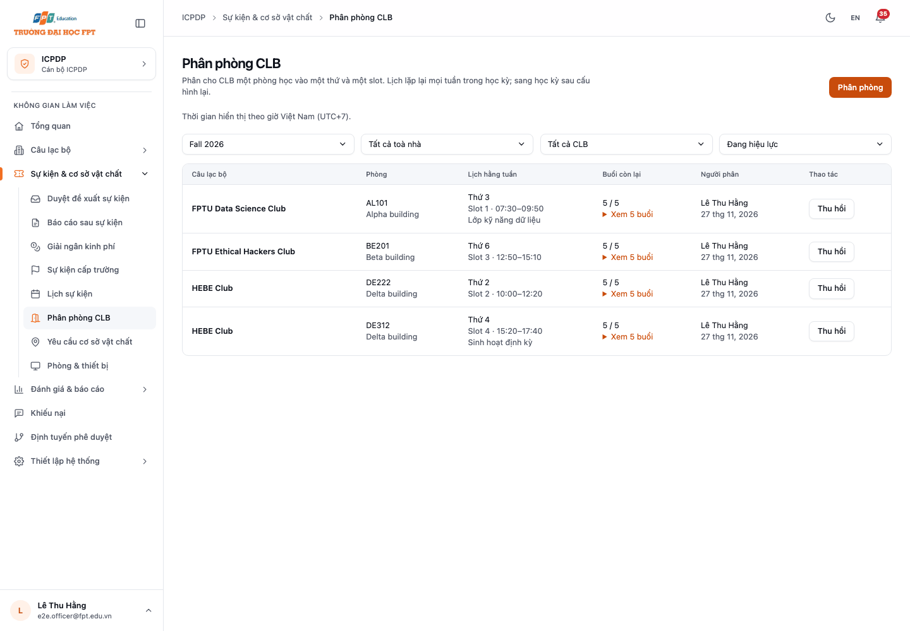

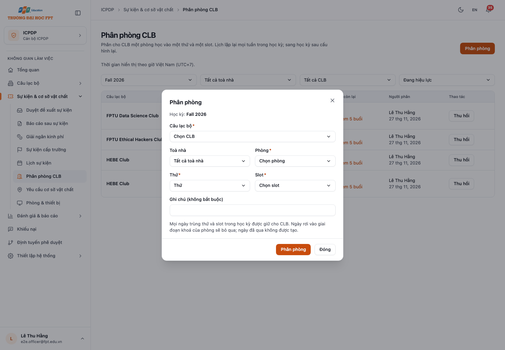

### 12.3. CLB xem phòng được phân

**Vai trò:** mọi thành viên `Active` của CLB (quyền mặc định `club.room.view`), thường là người đi
nhận chìa khoá. **Nơi bắt đầu:** **Phòng được phân**
(`/club/:clubId/rooms`).

1. Xem lịch tuần của học kỳ hiện tại và sắp tới: thứ, slot, giờ, phòng, toà nhà, ghi chú.
2. Xem danh sách các buổi sắp tới.
3. Xuất trình màn hình này cho bảo vệ để nhận chìa khoá phòng.

**Kết quả:** màn hình chỉ để xem; CLB không đặt, huỷ hay xin phòng học trên app. CLB bị tạm
ngừng hoặc giải thể mất các buổi tương lai.

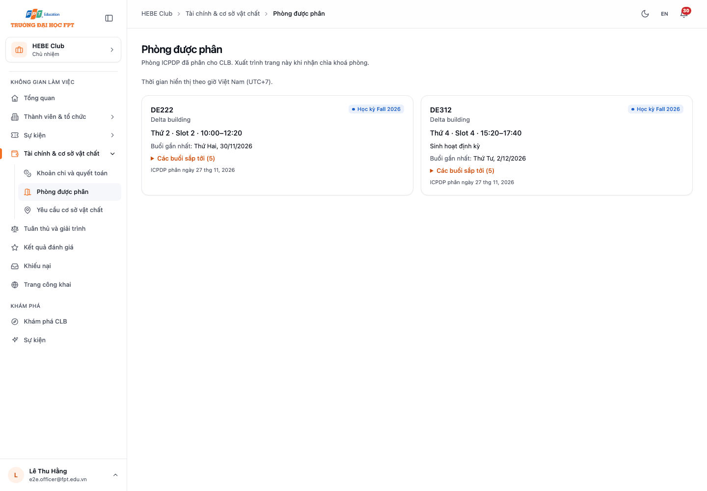

### 12.4. Yêu cầu cơ sở vật chất và thẩm định

**Vai trò:** Club Leader; ICPDP thẩm định.

1. CLB mở **Yêu cầu cơ sở vật chất** (`/club/:clubId/bookings`), bấm nút **Yêu cầu cơ sở vật
   chất**; chọn ngày, slot và cơ sở vật chất, nhập mục đích và số người dự kiến; **Lưu bản nháp**
   rồi gửi.
2. ICPDP mở **Yêu cầu cơ sở vật chất** (`/workspace/bookings`), nhận xử lý, kiểm tra xung đột,
   nhu cầu và nghĩa vụ CLB; duyệt, từ chối hoặc yêu cầu sửa, có thể đề xuất tài sản/giờ khác.
3. Khi bị trả sửa, CLB sửa và nộp lại; app tạo bản mới.
4. Không dùng nữa thì huỷ hoặc trả cơ sở vật chất theo thời hạn app hiển thị.

**Kết quả:** trùng khung giờ đã được giữ thì không duyệt được. CLB đang tạm ngừng không gửi
yêu cầu mới được. Chỉ yêu cầu đã duyệt mới là lịch sử dụng chính thức.

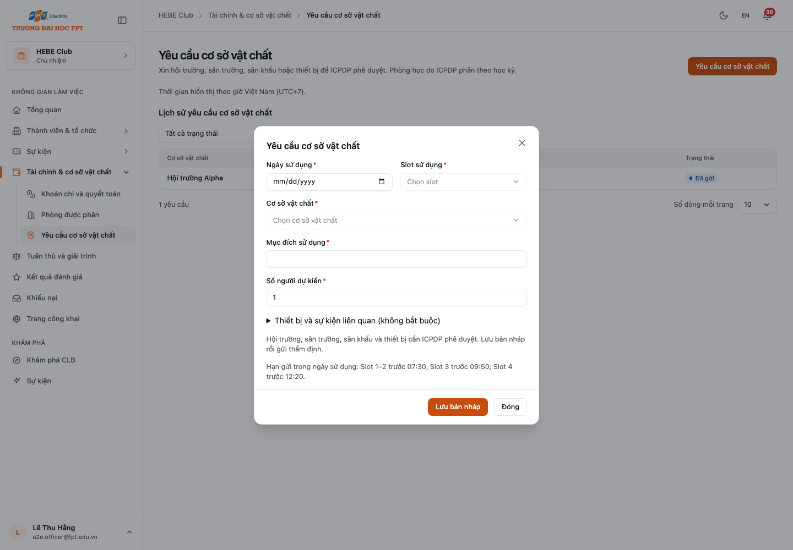

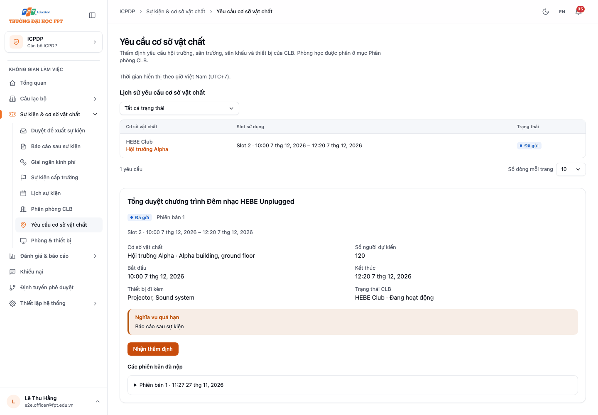

## 13. Báo cáo sau sự kiện

**Vai trò:** Club Leader. **Nơi bắt đầu:** **Báo cáo sau sự kiện**
(`/club/:clubId/event-reports`).

1. Chọn sự kiện đã kết thúc và đã chốt điểm danh.
2. Đọc số liệu nạp sẵn: đề xuất, điểm danh, ngân sách, khoản chi và phản hồi đủ ngưỡng.
3. Nhập kết quả thực tế, sự cố, bài học; thêm liên kết HTTPS tới minh chứng.
4. Chọn **Lưu bản nháp**; sửa xong thì lưu lại trước khi **Nộp**.
5. Xác nhận nộp; kiểm tra trạng thái `Submitted` và số liệu snapshot đã đóng băng.
6. Nếu ICPDP trả sửa, đọc lý do, sửa, lưu và nộp lại. App tạo bản mới và giữ lịch sử.

**Kết quả:** sự kiện chuyển `Report Submitted`. Nộp trễ vẫn được nhận nhưng bị đánh dấu trễ.
Sự kiện chỉ dành cho thành viên CLB mà không xin ngân sách thì không phải nộp báo cáo. Màn
này cần chính sách có cấu hình hạn nộp báo cáo sau sự kiện.

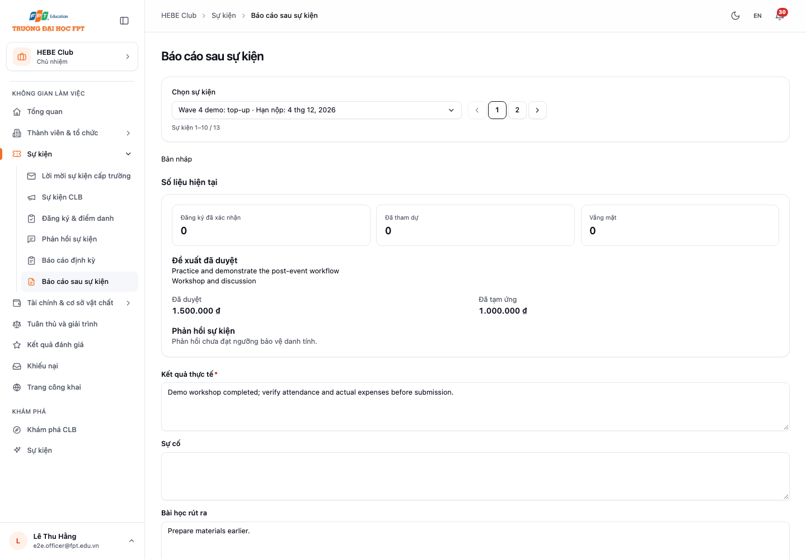

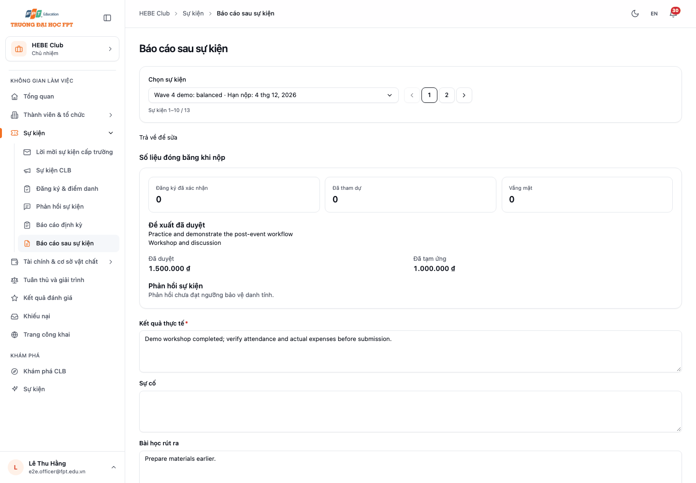

## 14. ICPDP thẩm định báo cáo sau sự kiện

**Nơi bắt đầu:** **Báo cáo sau sự kiện** (`/workspace/event-reports`).

1. Chọn sự kiện chờ xét và nhận thẩm định.
2. Đối chiếu snapshot đã nộp với số liệu hiện tại và điều kiện duyệt đề xuất.
3. Nhập lý do, chọn **Chấp nhận** để đóng sự kiện hoặc **Trả về để sửa**.
4. Nếu có sai phạm, chọn mức độ để mở hồ sơ vi phạm (chương 17) kèm quyết định.
5. Khi số liệu điểm danh mâu thuẫn, app chỉ cho trả về để sửa.
6. Với sự kiện quá hạn mà CLB chưa nộp, ghi nhận không nộp từ danh sách báo cáo thiếu.

**Kết quả:** chấp nhận → sự kiện `Closed`; trả sửa → sự kiện quay về `Completed`. Đóng sự
kiện không tự tất toán ngân sách.

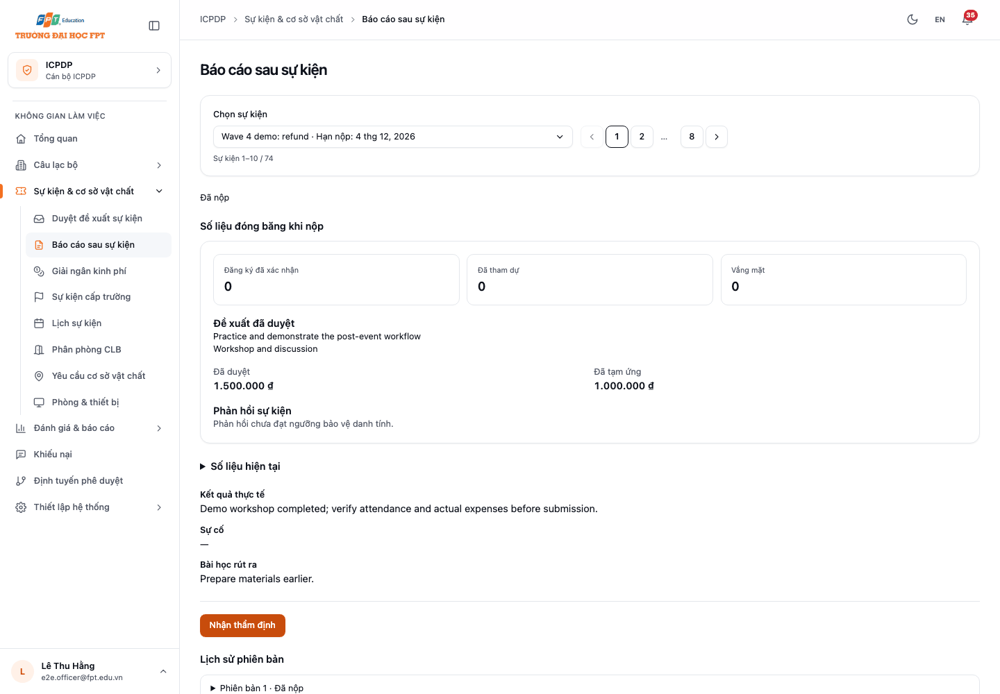

## 15. Báo cáo định kỳ

**Vai trò:** ICPDP. **Nơi bắt đầu:** **Báo cáo định kỳ** (`/workspace/periodic-reports`).

1. Lọc: Tất cả / Chờ thẩm định / Quá hạn / Đã chấp nhận. Mỗi dòng có nhãn Quá hạn, Nộp trễ và
   số lần nộp.
2. Với CLB quá hạn chưa nộp: bấm **Ghi nhận không nộp**, chọn mức độ, ghi chú rồi
   **Ghi nhận**. App mở hồ sơ vi phạm tương ứng.
3. Bấm **Thẩm định**; so sánh **Số liệu** trong báo cáo với số liệu hệ thống hiện tại.
4. Ở **Quyết định của bạn**, chọn **Chấp nhận** (có thể nhập ghi nhận cho kỳ đánh giá) hoặc
   **Trả về để sửa** (bắt buộc nhận xét và chọn ít nhất một phần cần sửa).
5. Bấm **Xác nhận quyết định**.

**Kết quả:** báo cáo chuyển Đã chấp nhận hoặc Đã trả về; báo cáo được chấp nhận là đầu vào
đánh giá CLB: nếu kỳ đã có tiêu chí đánh giá đang áp dụng, app tự sinh bản nháp đánh giá của CLB đó
cho kỳ (xem mục 18.2). Loại báo cáo và các mốc hạn nộp/nhắc/quá hạn cấu hình trong chính sách.

**Phía CLB:** Club Leader mở **Báo cáo định kỳ** (`/club/:clubId/periodic-reports`), chọn kỳ đang mở
nhận báo cáo và điền theo biểu mẫu ICPDP: danh sách thành viên hoạt động trong kỳ (kèm điểm phong
trào), các sự kiện đã tổ chức (app tự lấy sự kiện trong kỳ; CLB thêm, bớt hoặc sửa) và thành tích.
Mỗi sự kiện, thành tích cần minh chứng: dán link ảnh `https://…` hoặc tải ảnh lên (dán ảnh trực tiếp
bằng Ctrl+V). Ảnh tải lên được lưu trên kho tệp của nhà trường, báo cáo chỉ giữ tham chiếu. Lưu nháp,
rồi nộp; khi bị trả về thì sửa đúng các phần được yêu cầu và nộp lại.

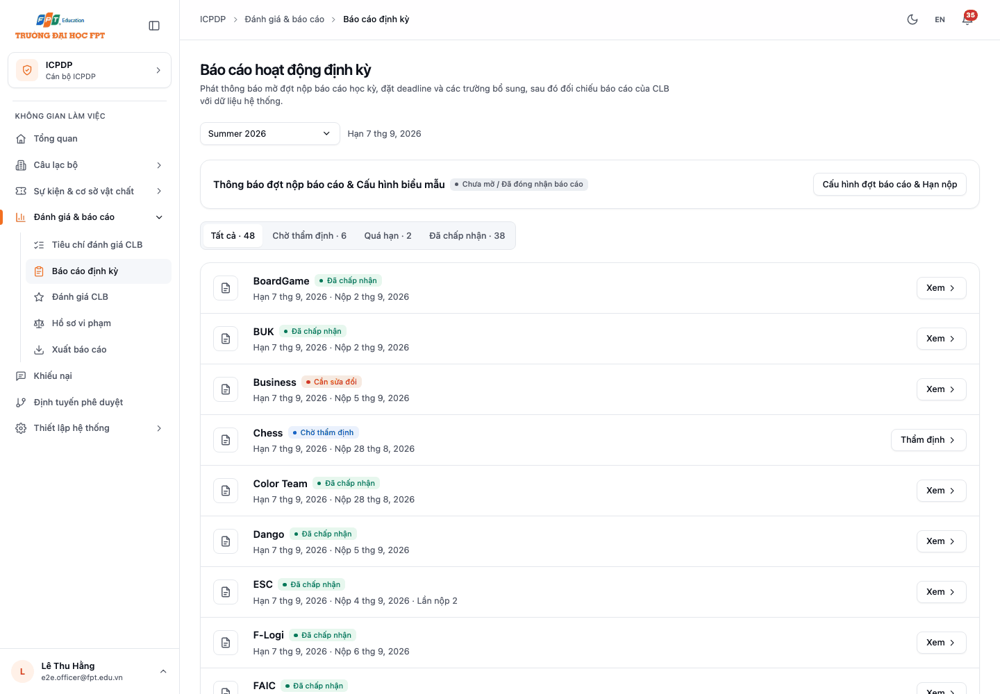

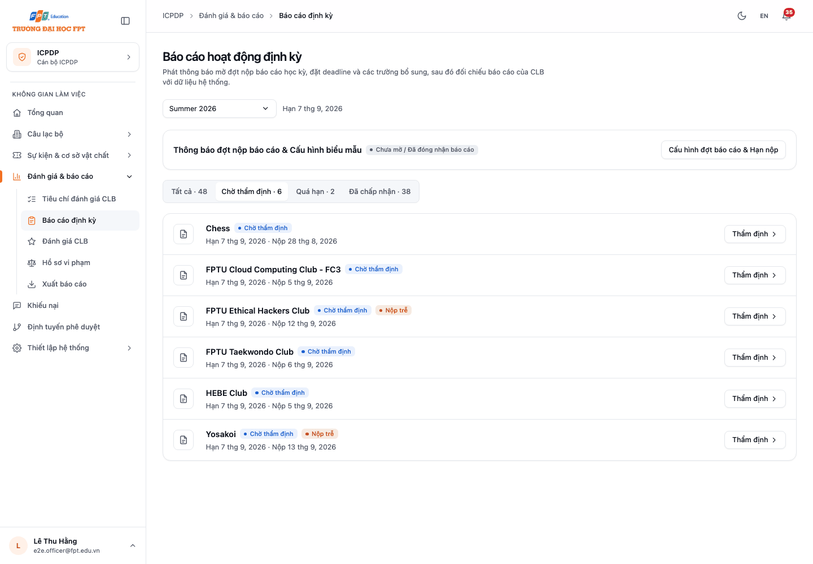

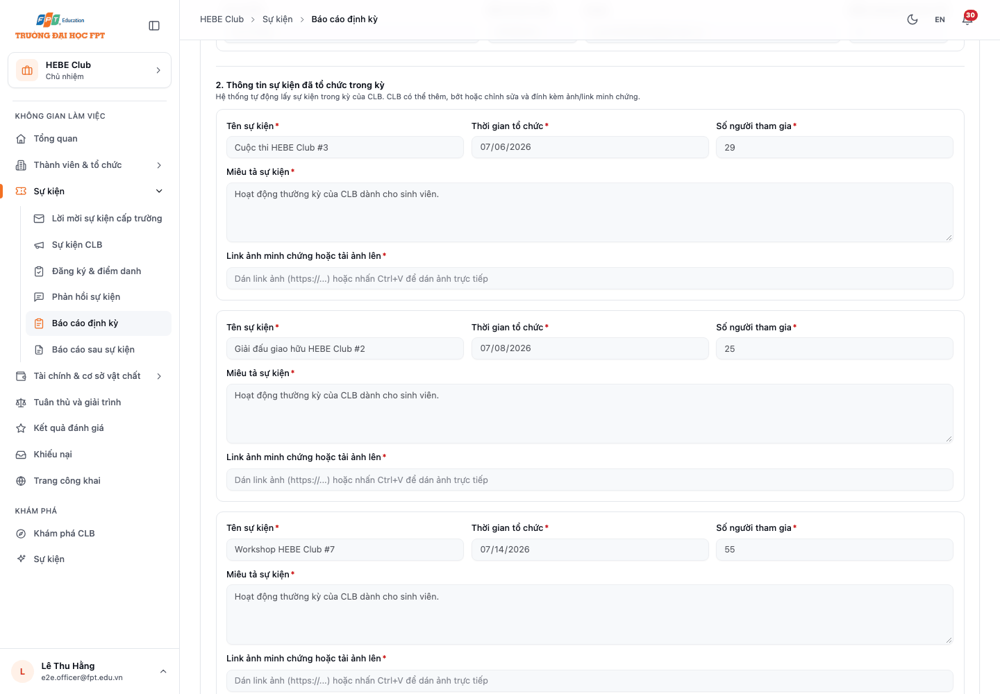

## 16. Kinh phí: tạm ứng, quyết toán, đối soát

Kinh phí đi theo **từng hạng mục** mà ICPDP đã quyết định tài trợ khi duyệt đề xuất (chương 8):

| Quyết định tài trợ | Cách chi | Việc của CLB sau sự kiện |
|---|---|---|
| Không tài trợ | CLB tự lo | Không có |
| Tài trợ · Trả trước | Nhà trường chuyển về cán bộ ICPDP phụ trách, cán bộ chuyển tạm ứng cho CLB (chưa cần hoá đơn) | Nộp chứng từ để đối soát, hoàn trả phần dư |
| Tài trợ · Trả sau, dưới 5.000.000 đ | CLB tự chi trước, nhận hoàn qua cán bộ ICPDP; hoặc lập hợp đồng để nhà trường trả thẳng nhà cung cấp | Nộp chứng từ để được thanh toán |
| Tài trợ · Trả sau, từ 5.000.000 đ | Bắt buộc lập hợp đồng; nhà trường chuyển thẳng cho nhà cung cấp | Nộp chứng từ và thông tin chuyển khoản nhà cung cấp |

App chỉ ghi nhận các bước, không chuyển tiền.

### 16.1. ICPDP chuyển tạm ứng trước sự kiện

**Nơi bắt đầu:** **Giải ngân kinh phí** (`/workspace/budgets`).

1. Lọc theo tab: Tất cả / Chờ giải ngân trước / Chờ đối soát / Chờ TT nhà cung cấp / Chờ xác nhận
   hoàn trả / Đang xử lý / Đã hoàn tất · Huỷ, hoặc theo CLB. Danh sách phân trang trên server, 20
   khoản mỗi trang.
2. Mở một khoản: phần **Giải ngân & chứng từ theo hạng mục** có tổng Đã duyệt, Khoản chi đã ghi,
   Đã giải ngân và từng hạng mục với trần tài trợ, hạn nộp chứng từ.
3. Với hạng mục **Chờ giải ngân trước**, sau khi nhận tiền từ nhà trường và chuyển cho CLB, bấm
   **Xác nhận đã chuyển tiền tạm ứng cho CLB**.
4. CLB bấm **Xác nhận CLB đã nhận tiền ứng** ở **Khoản chi và quyết toán**; hạng mục sang **Đã
   chuyển tiền ứng**.

### 16.2. CLB nộp chứng từ và hoàn trả

**Vai trò:** Club Leader. **Nơi bắt đầu:** **Khoản chi và quyết toán**
(`/club/:clubId/budgets`), chọn sự kiện.

1. Sau khi sự kiện kết thúc (cửa sổ nộp chứng từ mở từ lúc kết thúc tới 14 ngày sau), ở từng hạng
   mục nhập **Tổng giá trị hóa đơn / hợp đồng** và **Nội dung khoản chi**.
2. **Thêm chứng từ**: 1–5 tệp JPG/PNG (tối đa 5 MB) hoặc PDF (tối đa 10 MB); app từ chối tệp trùng.
   Hạng mục trả thẳng nhà cung cấp cần thêm **Thông tin chuyển khoản nhà cung cấp** (tên đơn vị,
   chủ tài khoản, số tài khoản, ngân hàng).
3. **Lưu nháp**, rồi **Nộp bộ chứng từ đầy đủ**. Hạng mục bị khoá và sang **Chờ đối soát**.
4. Khi hạng mục **Chờ CLB hoàn trả** (chi hợp lệ thấp hơn số đã ứng), bấm **Thực hiện hoàn trả**,
   xem số tài khoản nhà trường, chuyển khoản, tải 1–5 biên lai rồi **Gửi xác nhận đã hoàn trả**.
5. Với hạng mục CLB tự chi trước, khi cán bộ ICPDP chuyển tiền về, bấm **Xác nhận đã nhận tiền từ
   cán bộ ICPDP**.

**Kết quả:** ICPDP chỉ thấy thông tin và tệp sau khi CLB bấm nộp. Bị yêu cầu sửa thì CLB sửa trong
hạn gốc và nộp lại.

### 16.3. ICPDP đối soát và xác nhận

**Nơi bắt đầu:** chi tiết khoản kinh phí (`/workspace/budgets/:id`), tab **Chờ đối soát**.

1. Mở hạng mục **Chờ đối soát**, xem hoặc lưu chứng từ CLB đã tải lên (**Lưu tất cả chứng từ**).
2. Nhập **Giá trị chứng từ hợp lệ** và nhận xét, bấm **Duyệt đối soát**; hoặc **Yêu cầu sửa trong
   hạn gốc** kèm lý do. Số được thanh toán bằng giá trị hợp lệ nhưng không vượt trần tài trợ.
3. Hạng mục trả thẳng nhà cung cấp: sau khi nhà trường thanh toán, bấm **Xác nhận nhà trường đã
   thanh toán cho nhà cung cấp**.
4. Khi CLB gửi biên lai hoàn trả, bấm **Xác nhận đã nhận hoàn trả** hoặc **Yêu cầu gửi lại biên
   lai** (bắt buộc lý do).

| Hạng mục trả trước: chi hợp lệ so với số đã ứng | Kết quả |
|---|---|
| Bằng hoặc lớn hơn | **Đã đối soát** |
| Nhỏ hơn (kể cả bằng 0) | **Chờ CLB hoàn trả** → CLB gửi biên lai → ICPDP xác nhận → **Đã đối soát** |

**Kết quả:** khi mọi hạng mục đã kết thúc, khoản kinh phí tự đóng. Ngân sách tạo trước đợt đổi
luồng kinh phí (24/11/2026) vẫn mở bằng màn đối soát cũ (`/workspace/budgets/:id/reconciliation`).

## 17. Hồ sơ vi phạm

**Vai trò:** ICPDP. **Nơi bắt đầu:** **Hồ sơ vi phạm** (`/workspace/violations`). Hồ sơ cũng
được mở tự động từ thẩm định báo cáo, báo cáo định kỳ không nộp và đối soát tài chính.

1. Lọc: Đang xử lý / Chờ CLB giải trình / Đang khắc phục / Đã đóng / Tất cả (mỗi tab ghi số hồ
   sơ; danh sách phân trang, 20 hồ sơ mỗi trang).
2. Bấm **Mở hồ sơ**: chọn CLB, nguồn phát hiện, mức độ (Nhẹ / Trung bình / Nghiêm trọng),
   nhập sự việc, mô tả, sự kiện hoặc kinh phí liên quan.
3. Bấm **Bắt đầu điều tra**, dùng **Thêm chứng cứ** (ghi chú và liên kết).
4. **Yêu cầu CLB giải trình**: nhập nội dung và hạn trả lời (mặc định 7 ngày), bấm
   **Gửi cho CLB**. CLB trả lời ngoài hệ thống thì dùng **Ghi nhận giải trình của CLB** hoặc
   **Ghi nhận CLB không phản hồi**.
5. Ở **Quyết định**, chọn **Có vi phạm** hoặc **Không vi phạm**, nhập lý do và chứng cứ, bấm
   **Ra quyết định**. Có thể **Đóng hồ sơ — không vi phạm** bất cứ lúc nào trước đó (bắt
   buộc lý do).
6. **Giao biện pháp khắc phục** (mỗi biện pháp có hạn, có thể dẫn tới tạm ngừng hoặc giải
   thể); đánh dấu **Đã hoàn thành** / **Không hoàn thành**, rồi **Kết thúc hồ sơ**. Chỉ đánh dấu
   **Đã hoàn thành** được sau khi CLB đã nộp minh chứng; **Không hoàn thành** cần minh chứng
   hoặc đã quá hạn biện pháp.

**Kết quả:** kết luận có vi phạm cần ít nhất một chứng cứ và phải qua bước giải trình (hoặc
ghi nhận CLB không phản hồi). Biện pháp tạm ngừng/giải thể chỉ dẫn link sang quản lý CLB
(chương 20), không tự thực hiện. CLB xem hồ sơ, gửi giải trình và nộp
minh chứng khắc phục ở mục **Tuân thủ và giải trình** của workspace CLB (chưa có ảnh minh hoạ).

## 18. Đánh giá CLB

### 18.1. Tiêu chí đánh giá

**Vai trò:** ICPDP. **Nơi bắt đầu:** **Tiêu chí đánh giá CLB**
(`/workspace/evaluation-schemes`).

1. Ở **Tạo scheme**, chọn học kỳ và nguồn (mặc định của hệ thống hoặc một phiên bản cũ), bấm
   **Tạo bản nháp**.
2. Bấm **Sửa**: đặt trọng số (%) cho D1–D8 (có **Chia đều**), chọn tiêu chí ICPDP được chấm
   tay, đặt mức xếp loại Xuất sắc / Tốt / Khá.
3. **Lưu nháp**, rồi **Kích hoạt**. Muốn đổi scheme đang áp dụng, dùng **Tạo bản sửa**.

**Kết quả:** tổng trọng số phải đúng 100%; D1–D3 phải lớn hơn 0; các mức phải giảm dần.
Trạng thái: Bản nháp → Đang áp dụng → Đã thay thế.

### 18.2. Sinh, chốt và công bố kết quả

**Nơi bắt đầu:** **Đánh giá CLB** (`/workspace/evaluations`).

1. Chọn học kỳ; cần có scheme đang áp dụng (nếu chưa, dùng link mở tiêu chí đánh giá).
2. Bấm **Sinh bản nháp** cho mọi CLB đang hoạt động (CLB có báo cáo định kỳ đã được chấp nhận
   thường đã có sẵn bản nháp, trạng thái **Đã có dữ liệu**).
3. **Mở** từng CLB, xem dữ liệu nguồn của từng tiêu chí. Với tiêu chí cho chấm tay, nhập điểm
   0–100 và lý giải (bắt buộc), **Lưu điểm**.
4. Bấm **Chốt kết quả** (hoặc **Sinh lại từ dữ liệu hiện tại**); có thể **Mở lại để xem
   xét**.
5. Khi mọi CLB đã chốt, bấm **Công bố kết quả**.

**Kết quả:** xếp loại Xuất sắc / Tốt / Khá / Cần cải thiện. Tiêu chí thiếu dữ liệu ghi "chưa
đủ dữ liệu", không tính 0. Kết quả đã công bố không sửa trực tiếp; dùng **Tạo bản sửa**.

## 19. Khiếu nại và định tuyến phê duyệt

Khiếu nại luôn đi tới **ICPDP trước**; CLB chỉ thấy khiếu nại khi ICPDP chuyển xuống và **không bao giờ
thấy ai gửi** (BR38, D5).

**Sinh viên** — **Khiếu nại** (`/workspace/complaints`):

1. Chọn CLB (bắt buộc) và sự kiện liên quan nếu có; chọn loại (Hành vi / Sự kiện / Tiền bạc / An toàn /
   Khác); mô tả việc đã xảy ra; thêm tối đa 5 liên kết chứng cứ.
2. Bấm **Gửi ICPDP**; theo dõi trạng thái ở **Khiếu nại của tôi**. Khi ICPDP chưa quyết định có thể
   **Rút khiếu nại**. Nếu ICPDP thấy hai khiếu nại của bạn là cùng một sự việc, ICPDP gộp chúng và xử lý
   chung; khiếu nại được gộp hiện kết quả của khiếu nại kia.

**ICPDP** — **Khiếu nại** (`/workspace/complaint-review`; lọc theo trạng thái, phân trang trên server):

1. **Bắt đầu xem xét** một khiếu nại mới; thấy người gửi, chứng cứ và số khiếu nại đã gộp. Nếu cùng sinh viên
   còn khiếu nại chưa có quyết định về cùng CLB và là cùng sự việc, chọn khiếu nại đó ở **Gộp vào**, ghi lý do
   và bấm **Gộp**; khiếu nại được gộp rời hàng đợi và theo kết quả của khiếu nại kia.
2. **Ra quyết định** kèm mức độ, tính hợp lệ và lý do (bắt buộc): **Bác bỏ**, **Chuyển xuống CLB** (kèm
   hạn trả lời, mặc định 7 ngày) hoặc **Leo thang** (mở hồ sơ vi phạm, chương 17). CLB đã giải thể chỉ
   bác bỏ được.
3. Sau khi CLB trả lời: **Đóng** nếu hài lòng, hoặc **Leo thang**. Quá hạn mà CLB chưa trả lời thì ICPDP
   nhận cảnh báo.

**CLB** — **Khiếu nại** (`/club/:clubId/complaints`, cần quyền trả lời khiếu nại): đọc khiếu nại đã chuyển
xuống cùng ghi chú của ICPDP, gửi **một** lần trả lời gồm nội dung, hành động đã/sẽ làm và liên kết chứng
cứ. CLB không sửa, bác bỏ hay đóng khiếu nại.

**Định tuyến phê duyệt** — ICPDP (`/workspace/routing-rules`): rule đặt **SLA thẩm định** (số giờ) cho hồ sơ
thành lập CLB, đề xuất sự kiện (theo ngân sách, mức rủi ro) hay yêu cầu cơ sở vật chất (theo loại). Mọi hồ sơ
đều do một cán bộ ICPDP duyệt ở **một cấp**: nhận xử lý rồi quyết định là xong. Chỉ có một vai trò
**Cán bộ ICPDP**: mọi cán bộ đều xem, tạo bản nháp từ rule đang áp dụng (**Thêm rule**, **Lưu nháp**) và
**Kích hoạt** (chỉ áp cho hồ sơ mới), và **mô phỏng** rule trên các hồ sơ đã quyết định. Chưa có
rule nào thì hồ sơ không có SLA.

## 20. ICPDP quản lý vòng đời CLB

**Nơi bắt đầu:** **Quản lý CLB** (`/icpdp/clubs`).

1. Tìm bằng ô tìm kiếm; lọc theo trạng thái (Đang hoạt động / Tạm ngừng / Đang giải thể /
   Đã giải thể) và lĩnh vực.
2. Khung **Sắp hết hạn tạm ngừng** liệt kê CLB sắp tự kích hoạt lại; app nhắc trước 3 ngày.
3. Bấm **Quản lý** trên thẻ CLB; xem **Công việc đang chạy** (đợt tuyển đang mở, sự kiện sắp
   tới, nhiệm kỳ hiện tại).
4. Chọn **Tạm ngừng** (khi đang hoạt động): chọn **Đến một ngày** (nhập ngày tự kích hoạt lại)
   hoặc **Cho tới khi tôi kích hoạt lại**.
5. Hoặc **Kích hoạt lại** (khi đang tạm ngừng), hoặc **Giải thể**.
6. Nhập lý do (bắt buộc) và **Xác nhận**. Xem lại ở **Lịch sử vòng đời**.

**Kết quả:** tạm ngừng huỷ sự kiện sắp tới và booking đã duyệt; đợt tuyển vẫn hiện nhưng
không nhận đơn. CLB tự hoạt động lại khi đến ngày đã đặt. Giải thể có hiệu lực từ học kỳ kế
tiếp; nút bị khoá khi lịch năm học chưa có học kỳ kế tiếp.

**Yêu cầu tạm ngừng từ CLB.** Club Leader gửi ở **Yêu cầu tạm ngừng** (`/club/:clubId/suspension-requests`):
lý do, ngày dự kiến kết thúc, kế hoạch hoàn tất nghĩa vụ và kế hoạch hoạt động lại, xác nhận từng sự
kiện/booking bị ảnh hưởng. ICPDP xem ở **Yêu cầu tạm ngừng** (`/workspace/suspension-requests`), nhập
**Lý do quyết định** rồi bấm **Duyệt và tạm ngừng** hoặc **Từ chối**. CLB chỉ tạm ngừng khi ICPDP duyệt.

## 21. Thiết lập hệ thống

### Chính sách nhà trường

**Nơi bắt đầu:** **Chính sách nhà trường** (`/workspace/policy`).

1. Xem **Chính sách đang hiệu lực**, **Lịch sử phiên bản** (Đã lên lịch / Đã có hiệu lực) và
   **Xem giá trị chính sách**.
2. Ở **Phiên bản chính sách mới**, sửa các nhóm: thành lập CLB (số người sáng lập tối thiểu,
   mục bắt buộc), hồ sơ CLB, sự kiện (hạn phản hồi, số phản hồi tối thiểu, ngưỡng trùng lịch,
   ngoại lệ overbooking), năm học (**Thêm học kỳ** / **Bỏ học kỳ**), báo cáo (**Thêm loại báo
   cáo**, hạn nộp/nhắc/quá hạn/leo thang, chặn đề xuất sự kiện khi CLB còn báo cáo quá hạn).
3. Đặt ngày hiệu lực (để trống = áp dụng ngay) và lý do thay đổi.
4. Bấm **Tạo phiên bản chính sách**. Rời trang khi chưa lưu thì app hỏi **Bỏ thay đổi?**; chọn
   **Rời trang** để bỏ hoặc **Huỷ** để ở lại.

**Kết quả:** mỗi thao tác dùng chính sách có hiệu lực tại thời điểm đó. Phải giữ ít nhất một
học kỳ và một loại báo cáo. App cảnh báo nếu phiên bản mới làm vô hiệu một quyết định đã ban
hành.

### Lĩnh vực CLB

**Nơi bắt đầu:** **Lĩnh vực CLB** (`/workspace/club-fields`).

1. Ở **Lĩnh vực mới**, nhập tên và thứ tự (số nhỏ hiện trước), bấm **Thêm lĩnh vực**.
2. **Sửa** → **Lưu** để đổi tên; tên mới được cập nhật cho mọi CLB và hồ sơ đang dùng.
3. **Xoá** → xác nhận. Lĩnh vực đang được dùng chỉ bị ẩn (nhãn **Đã ẩn**).

### Tài khoản & phân quyền

**Nơi bắt đầu:** **Tài khoản & phân quyền** (`/icpdp/accounts`).

1. Tìm theo tên hoặc email; mỗi dòng có trạng thái Hoạt động / Đã khóa.
2. Bấm **Quản lý**. Hệ thống chỉ có một vai trò **Cán bộ ICPDP** (vào không gian ICPDP, duyệt hồ sơ,
   cấu hình định tuyến và mở khoá điểm danh đã chốt); mỗi lần đổi vai trò, người dùng bị đăng xuất
   để vai trò mới có hiệu lực.
3. Nhập lý do, bấm **Cấp vai trò**, **Thu hồi vai trò**, **Khóa tài khoản** hoặc **Mở khóa tài
   khoản**.

**Kết quả:** thu hồi, khoá và mở khoá bắt buộc có lý do. Mọi thay đổi quyền được ghi audit.

## 22. Xuất dữ liệu

**Vai trò:** ICPDP. **Nơi bắt đầu:** **Xuất báo cáo** (`/workspace/exports`).

1. Chọn dữ liệu: CLB và trạng thái / Thành viên theo CLB / Sự kiện kèm đăng ký và điểm danh /
   Ngân sách, giải ngân và đối soát / Hồ sơ vi phạm và góp ý / Kết quả đánh giá đã công bố.
2. Chọn thời gian: Toàn bộ / Theo học kỳ / Khoảng ngày; lọc theo CLB và trạng thái.
3. Chọn định dạng XLSX, CSV hoặc PDF.
4. Bấm **Đếm số dòng**, rồi **Tải xuống**.

**Kết quả:** không tải được khi kết quả có 0 dòng. Mỗi lần xuất được ghi lại.

## 23. Tổng quan ICPDP và xử lý lỗi thường gặp

ICPDP mở **Tổng quan** (`/icpdp`) để theo dõi việc đang chờ, nghĩa vụ và số liệu chung, rồi
đi vào từng hồ sơ để xử lý. Sinh viên và CLB cũng có trang **Tổng quan** riêng với các thẻ số
liệu và lối tắt.

| Tình huống | Cách xử lý |
|---|---|
| Bị chuyển về trang đăng nhập | Khu làm việc cần đăng nhập (khu công khai thì không); đăng nhập lại, app quay về trang đang xem |
| Hộp thoại "Bỏ thay đổi?" khi rời trang | Form đề xuất sự kiện hoặc chính sách còn thay đổi chưa lưu; chọn **Rời trang** để bỏ, hoặc huỷ rồi lưu trước |
| Không thấy mục quản lý | Chỉ Club Leader (Chủ nhiệm, Phó chủ nhiệm đã xác nhận) thấy; Club Member chỉ xem |
| "Không thể truy cập workspace" | Bấm **Chọn không gian làm việc** và chọn không gian bạn có quyền |
| Phiên hết hạn | Đăng nhập lại, mở lại hồ sơ và đọc trạng thái mới nhất |
| Hồ sơ đã thay đổi hoặc HTTP 409 | Tải lại trang, đối chiếu dữ liệu mới rồi thao tác lại |
| Officer khác đã nhận task | Chọn task khác hoặc chờ người đó xử lý xong |
| Báo cáo báo thiếu cấu hình hoặc HTTP 503 | Kiểm tra chính sách có loại báo cáo và hạn nộp tương ứng |
| Hạng mục kinh phí bị khoá | CLB đã nộp bộ chứng từ; chờ ICPDP đối soát hoặc yêu cầu sửa |
| Không thấy tổng hợp phản hồi | Số phản hồi chưa đạt ngưỡng tối thiểu trong chính sách |
| Không nộp được chứng từ | Cửa sổ nộp mở từ khi sự kiện kết thúc tới 14 ngày sau; kiểm tra định dạng và số tệp (tối đa 5) |

## Phụ lục — Dữ liệu và nguồn ảnh

- Toàn bộ 73 ảnh chụp tự động bằng `npm run guide:screenshots` (Playwright) ngày 27/11/2026 (ảnh 14,
  15, 54, 72 và 73 chụp lại ngày 28/11/2026), giao
  diện tiếng Việt, theme sáng, khung nhìn 1440 × 1000. Cách chụp lại ở [README.md](README.md).
- Ảnh chụp từ app thật (API + bản build client) chạy trên database riêng `ucms-e2e-guide`, được seed
  lại mỗi lần chụp từ các seed có sẵn của repo cộng dữ liệu riêng cho guide (hồ sơ thành lập chờ
  duyệt, báo cáo sau sự kiện ở từng trạng thái, kinh phí "Đêm nhạc gây quỹ HEBE", yêu cầu cơ sở vật
  chất, khiếu nại đã chuyển CLB, một ghế Phó chủ nhiệm còn trống ở HEBE Club, buổi bảo vệ đề án
  "Hackathon An toàn thông tin 24h" đang diễn ra, hai báo cáo định kỳ Summer 2026 được chấp nhận để
  sinh bản nháp đánh giá). Không chặn hay giả lập request API.
- Tài khoản dùng để chụp: "Lê Thu Hằng" (`e2e.officer@fpt.edu.vn`, vừa là cán bộ ICPDP, vừa là
  Chủ nhiệm HEBE Club và thành viên Mây Mưa Club), Nguyễn Văn Lan (sinh viên chưa vào CLB nào) và Võ
  Ngọc Hà (thành viên HEBE Club). Mọi tên, email và liên kết trong ảnh là dữ liệu mẫu.
- Sự kiện "Wave 3 demo" / "Wave 4 demo" là dữ liệu mẫu. Khi chụp không có kho tệp Cloudinary nên
  ô xem trước tệp đính kèm (đề án, hoá đơn) báo không tải được; trên hệ thống thật tệp hiển thị bình thường.
- Chi tiết URL, tài khoản và thao tác trước khi chụp của từng ảnh ở `images/manifest.json`.
