# UCMS — Guide book hướng dẫn sử dụng

Phiên bản 11/10/2026 · Giao diện tiếng Việt · Student, CLB và ICPDP.

Hướng dẫn các luồng chính từ khám phá CLB, nộp hồ sơ, tuyển thành viên, tổ chức sự kiện,
phân phòng, đặt cơ sở vật chất đến báo cáo và quyết toán. Mỗi luồng có nơi bắt đầu, điều
kiện, từng bước thao tác và kết quả cần kiểm tra.

Ảnh được chụp từ app với API và MongoDB thật sau khi seed. Các màn wave 4 dùng database
`ucms_guide_demo` riêng và policy mẫu; server chính chưa bật UC36/UC37. Google OAuth chưa
được kiểm thử lại trong đợt chụp: phiên local được cấp qua SessionService.

## Mục lục

1. Bắt đầu: khám phá và đăng nhập.
2. Chọn không gian làm việc.
3. Nộp hồ sơ thành lập CLB và theo dõi thẩm định.
4. Tuyển thành viên: công bố đợt tuyển → ứng tuyển → xét → tiếp nhận.
5. Quản lý thành viên và yêu cầu rời CLB.
6. Sự kiện: đề xuất → duyệt → công bố.
7. Đăng ký sự kiện, check-in và phản hồi.
8. CLB chốt điểm danh và xem phản hồi tổng hợp.
9. Phân phòng học và đặt cơ sở vật chất khác.
10. Báo cáo sau sự kiện và nộp lại.
11. ICPDP thẩm định báo cáo.
12. Ghi nhận tạm ứng.
13. Ghi khoản chi, chứng từ và nộp quyết toán.
14. Đối soát, cấp bù và hoàn trả.
15. ICPDP theo dõi tổng quan và xử lý lỗi thường gặp.

## 1. Khám phá và đăng nhập

**Nơi bắt đầu:** trang chủ `/`, danh bạ `/clubs`, sự kiện `/events`.

1. Mở trang chủ, chọn mục CLB hoặc sự kiện.
2. Trong danh bạ, tìm tên CLB; dùng bộ lọc để thu hẹp danh sách.
3. Mở chi tiết CLB để xem giới thiệu, các đợt tuyển và hoạt động.
4. Chọn đăng nhập khi muốn nộp đơn, đăng ký sự kiện hoặc vào không gian làm việc.
5. Dùng tài khoản Google thuộc domain mà nhà trường cho phép. Nếu có nhiều tài khoản
   Google trong trình duyệt, chọn đúng tài khoản sinh viên hoặc cán bộ.

**Kết quả:** sau khi đăng nhập thành công, app hiển thị các không gian mà tài khoản có quyền.
Không cần đăng nhập để xem thông tin công khai.

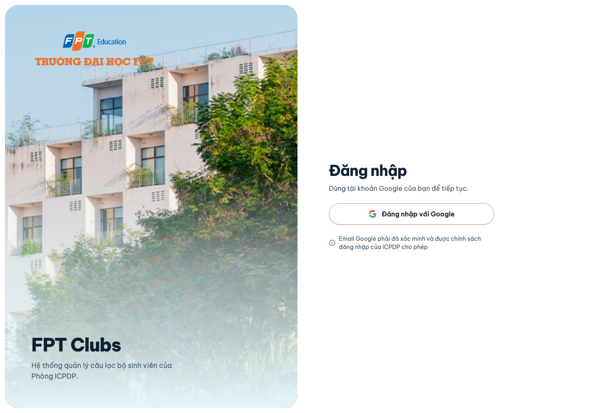

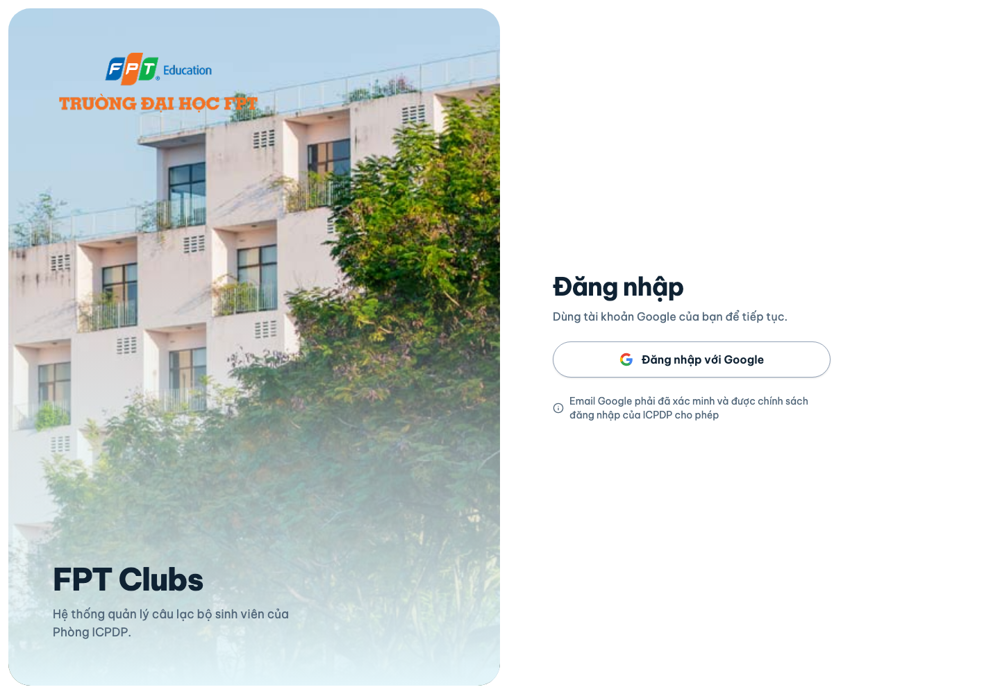

## 2. Chọn không gian làm việc

**Nơi bắt đầu:** `/workspace`.

1. Chọn **Student** để quản lý hồ sơ cá nhân, đơn ứng tuyển và sự kiện đã đăng ký.
2. Chọn không gian CLB để thực hiện công việc được phân quyền trong CLB đó.
3. Cán bộ chọn **ICPDP** để thẩm định và quản trị.
4. Khi cần đổi vai trò hoặc CLB, bấm ô tên không gian ở đầu thanh bên để trở lại trang chọn.
5. Dùng nút đổi ngôn ngữ và theme ở cuối thanh bên nếu cần.

**Kết quả:** thanh bên thay đổi theo không gian và quyền hiện có. Không thấy một mục quản lý
thường có nghĩa là tài khoản chưa được cấp permission tương ứng.

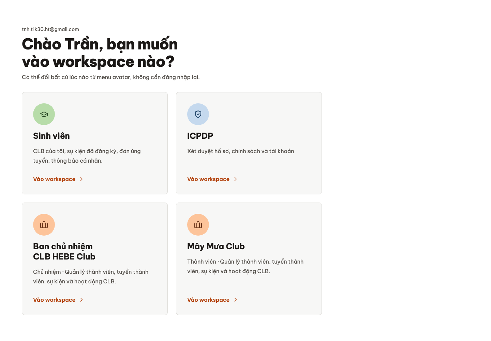

## 3. Nộp hồ sơ thành lập CLB

**Vai trò:** Student. **Nơi bắt đầu:** Hồ sơ thành lập CLB → tạo hồ sơ mới
(`/workspace/applications/new`).

1. Nhập tên CLB, lĩnh vực, giới thiệu, mục tiêu và thông tin liên hệ theo yêu cầu hiển thị.
2. Sang bước thành viên sáng lập; thêm tài khoản bằng email và phân vai trò Chủ nhiệm,
   Phó chủ nhiệm, Thành viên. Số người tối thiểu lấy từ policy của trường.
3. Tải đề án PDF/DOCX và logo PNG/JPG theo giới hạn dung lượng ghi trên màn hình.
4. Chọn bước kiểm tra. Xử lý từng mục còn thiếu trước khi nộp.
5. Lưu bản nháp để tiếp tục sau, hoặc nộp khi app báo hồ sơ đủ điều kiện.
6. Về danh sách hồ sơ để theo dõi trạng thái và lý do quyết định. Khi bị yêu cầu chỉnh sửa,
   sửa các phần được yêu cầu rồi nộp lại; lịch sử bản đã nộp vẫn được giữ.

**Kết quả:** hồ sơ chuyển từ `Draft` sang `Submitted`. Nếu được duyệt, app tạo CLB và không gian
làm việc theo vai trò được xác nhận. Upload chỉ hoạt động khi dịch vụ lưu file đã cấu hình.

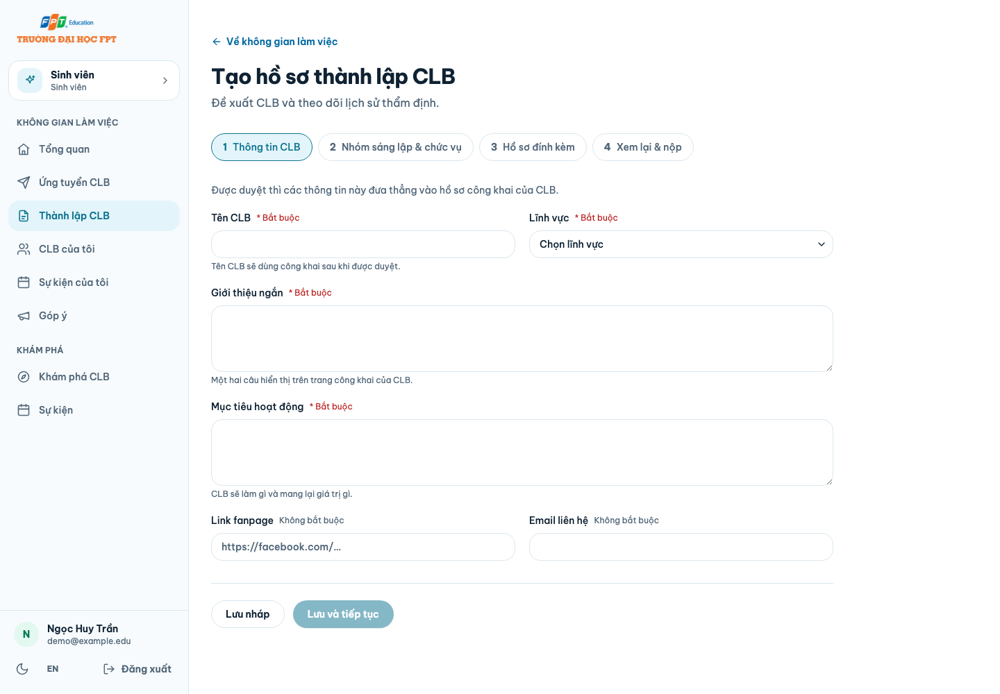

**Phía ICPDP:** mở hàng đợi hồ sơ, chọn hồ sơ, nhận thẩm định, kiểm tra các phần và file đính
kèm. Ghi lý do/những phần cần sửa rồi chọn duyệt, yêu cầu chỉnh sửa hoặc từ chối.

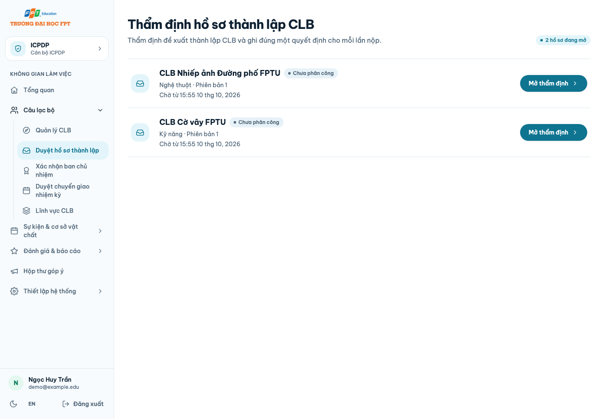

## 4. Tuyển thành viên

**Vai trò:** CLB có quyền quản lý tuyển thành viên; Student ứng tuyển.

1. CLB mở **Tuyển thành viên** (`/club/:clubId/recruitment`), tạo đợt tuyển.
2. Nhập tên, vị trí, tiêu chí, thời gian nhận đơn, chỉ tiêu và các bước tuyển chọn.
3. Thiết lập câu hỏi ứng tuyển và rubric đánh giá; lưu nháp rồi công bố đợt tuyển.
4. Student mở đợt tuyển từ trang chi tiết CLB, chọn vị trí, điền câu trả lời và file yêu cầu.
5. Student lưu nháp hoặc nộp đơn; theo dõi quyết định trong danh sách đơn ứng tuyển.
6. CLB mở danh sách xét tuyển của đợt; đọc đơn, ghi đánh giá theo rubric và lý do quyết định.
7. Với ứng viên được chấp nhận, CLB thực hiện tiếp nhận vào danh sách thành viên. Kiểm tra
   trạng thái `Onboarded`; trạng thái `Accepted` chưa đồng nghĩa với đã trở thành thành viên.

**Kết quả:** đợt tuyển công khai trong khoảng nhận đơn; các quyết định giữ lịch sử và lý do.
Đợt hết hạn hoặc CLB đang đình chỉ có thể vẫn xem được nhưng không nhận đơn mới.

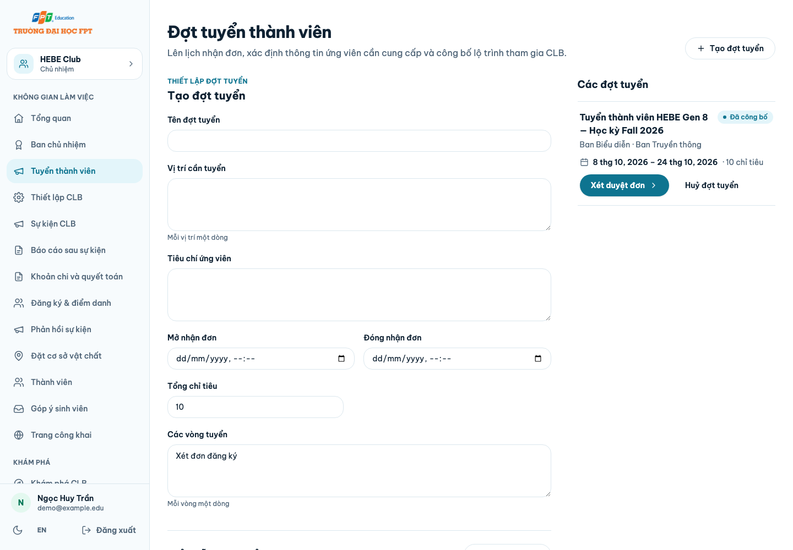

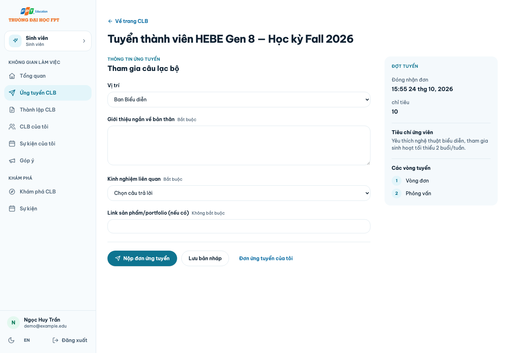

## 5. Thành viên và yêu cầu rời CLB

**Nơi bắt đầu:** CLB → **Thành viên**; Student → CLB của tôi → không gian thành viên.

1. Cán bộ CLB tìm theo tên/email, lọc trạng thái hoặc chức vụ.
2. Chọn **Đổi trạng thái**, nhập lý do nếu được yêu cầu và xác nhận.
3. Mở **Lịch sử trạng thái** để kiểm tra thay đổi; dùng **Xuất Excel** khi cần danh sách.
4. Student mở không gian thành viên để xem ban chủ nhiệm, hoạt động và thông tin thành viên.
5. Khi muốn rời CLB, tạo yêu cầu, ghi lý do và ngày có hiệu lực.
6. CLB theo dõi khu vực yêu cầu rời. Chỉ thực hiện khi đến ngày có hiệu lực và các điều kiện
   app yêu cầu đã được giải quyết.

**Kết quả:** trạng thái thành viên và lịch sử được cập nhật. Yêu cầu rời đang chờ hoặc bị giữ
chưa đồng nghĩa với đã rời CLB.

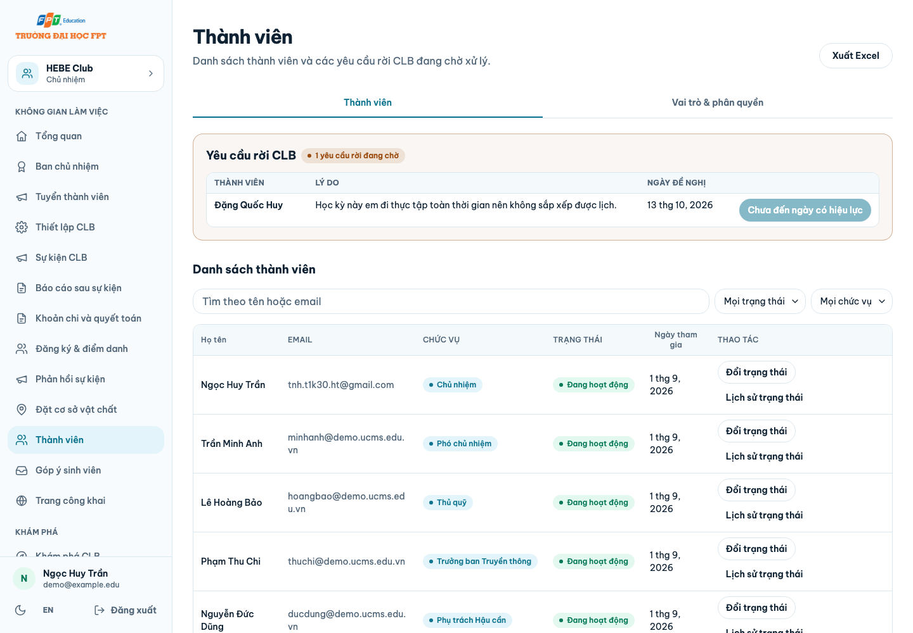

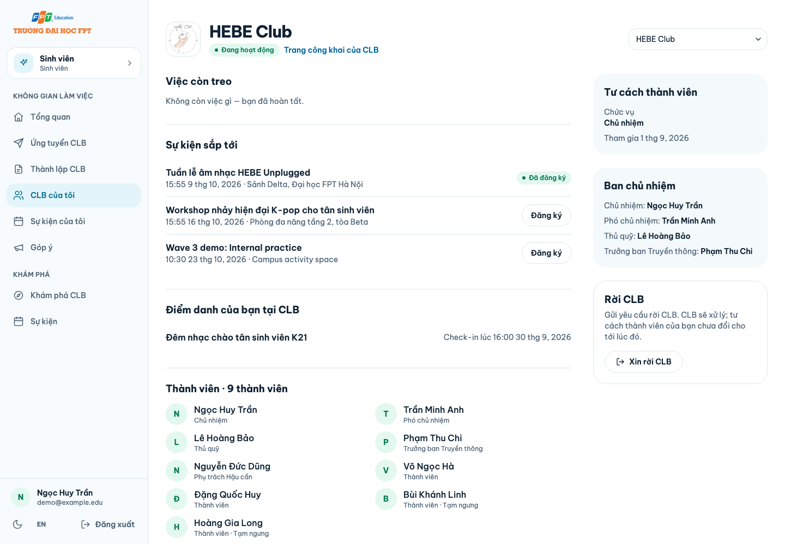

## 6. Đề xuất, duyệt và công bố sự kiện

**Vai trò:** CLB có quyền quản lý sự kiện; ICPDP thẩm định.

1. CLB mở **Sự kiện CLB**, tạo đề xuất (`/club/:clubId/events`).
2. Nhập mục tiêu, kế hoạch, lịch, địa điểm, đối tượng, sức chứa, rủi ro, booking liên quan
   (hội trường, sân, sân khấu, thiết bị; không gắn phòng học) và ngân sách theo hạng mục nếu xin kinh phí.
3. Lưu nháp, rà soát rồi gửi đề xuất trước thời hạn app quy định.
4. ICPDP mở **Duyệt đề xuất sự kiện**, nhận thẩm định. Đối chiếu lịch, rủi ro, địa điểm,
   nghĩa vụ CLB và từng dòng ngân sách; ghi điều kiện/lý do quyết định.
5. Nếu bị yêu cầu chỉnh sửa, CLB tạo bản sửa và nộp lại trước hạn hiển thị.
6. Với sự kiện đã duyệt, CLB thiết lập thời gian đăng ký/check-in, danh sách chờ và quyền
   walk-in theo nhu cầu rồi công bố.

**Kết quả:** sự kiện công bố xuất hiện cho đúng đối tượng; các version đề xuất và quyết định
cũ vẫn được giữ. Sự kiện nội bộ không xin ngân sách có nhánh ghi nhận riêng theo BR53.

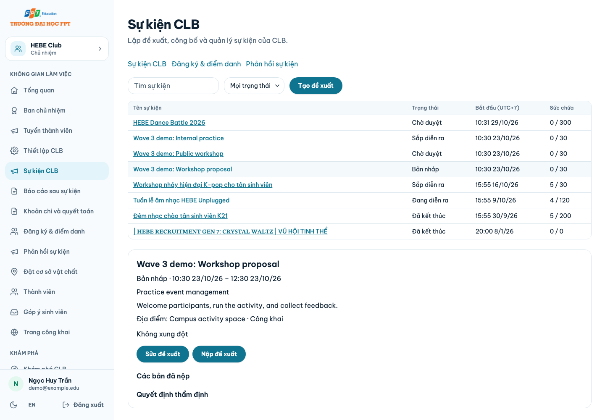

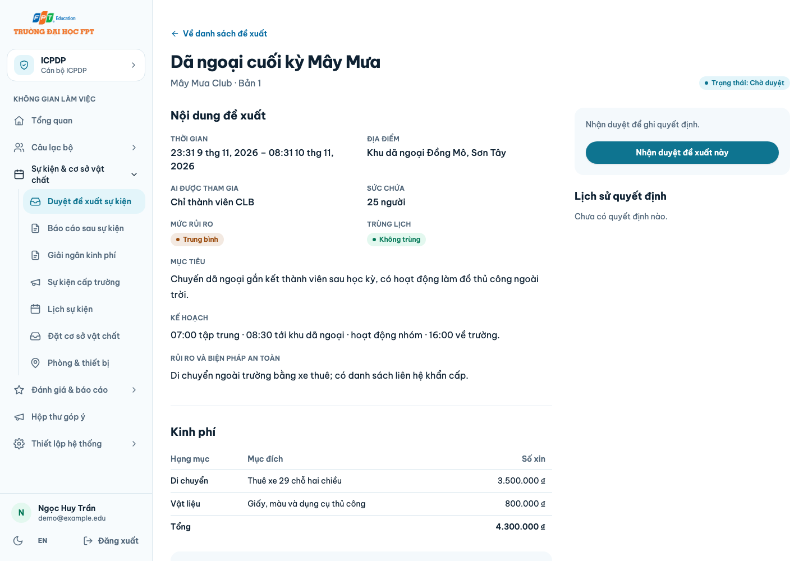

## 7. Đăng ký sự kiện, check-in và gửi phản hồi

**Vai trò:** Student. **Nơi bắt đầu:** chi tiết sự kiện → đăng ký;
**Sự kiện của tôi** (`/workspace/event-registrations`).

1. Xem thời gian, địa điểm, điều kiện và điền câu hỏi đăng ký trên trang sự kiện.
2. Sau khi nộp, kiểm tra `Confirmed` hoặc `Waitlisted`. Danh sách chờ chưa đảm bảo có chỗ.
3. Khi đến sự kiện, mở luồng check-in bằng QR hoặc mã do ban tổ chức cung cấp trong thời
   gian được phép. Kiểm tra thông báo xác nhận đã điểm danh.
4. Nếu không tham dự, huỷ đăng ký trong thời gian app cho phép; vị trí có thể được chuyển
   cho người trong danh sách chờ.
5. Sau khi tham dự, mở mục đã tham gia để gửi điểm đánh giá và nhận xét trong hạn phản hồi.

**Kết quả:** đăng ký, điểm danh và phản hồi là ba bước riêng; đăng ký thành công chưa đồng nghĩa
với đã tham dự. App không nhận phản hồi khi không đủ điều kiện hoặc đã quá hạn.

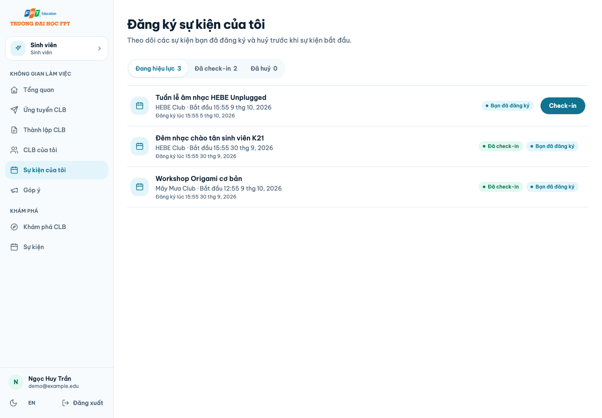

## 8. Chốt điểm danh và xem phản hồi

**Vai trò:** CLB có quyền điểm danh/xem phản hồi.

1. Mở **Đăng ký & điểm danh** (`/club/:clubId/event-attendance`), chọn sự kiện.
2. Đối chiếu danh sách người đăng ký với dữ liệu check-in; kiểm tra các trường hợp bất thường và ghi lý do sửa.
3. Chốt điểm danh sau khi sự kiện kết thúc. Kiểm tra số có mặt/vắng và trạng thái đã chốt.
4. Mở **Phản hồi sự kiện**, chọn sự kiện cần tổng hợp.
5. Xem số phản hồi, điểm trung bình và nhận xét khi đủ ngưỡng bảo vệ riêng tư.

**Kết quả:** số liệu đã chốt trở thành đầu vào báo cáo. Sau khi đã nộp báo cáo, app không cho
mở khoá điểm danh theo luồng thông thường. Chưa đủ người phản hồi thì phần tổng hợp được ẩn.

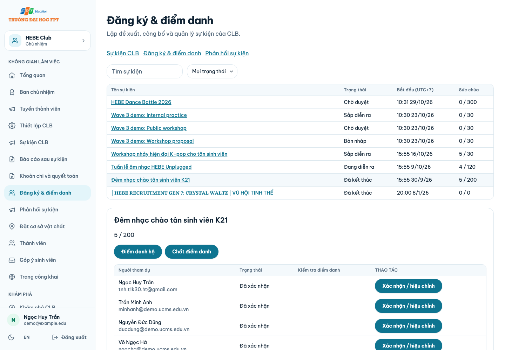

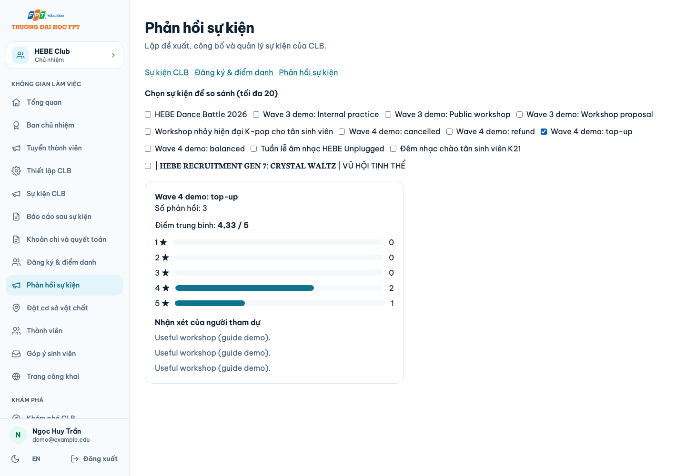

## 9. Phân phòng học và đặt cơ sở vật chất khác

Từ 11/10/2026 phòng học (`ROOM`) không còn do CLB tự đặt: ICPDP phân phòng cho CLB theo học
kỳ (UC58). CLB chỉ gửi yêu cầu cho hội trường, sân ngoài trời, sân khấu và thiết bị
(`HALL`, `OUTDOOR`, `STAGE`, `EQUIPMENT`).

### 9.1. ICPDP phân phòng CLB theo học kỳ

**Vai trò:** ICPDP. **Nơi bắt đầu:** **Phân phòng CLB** (`/workspace/room-allocations`),
nhóm thanh bên **Sự kiện & cơ sở vật chất**.

1. Chọn học kỳ (lấy từ lịch học kỳ của policy, chưa kết thúc). Danh sách hiện các đợt phân
   của học kỳ đó; lọc theo CLB hoặc toà nhà.
2. Chọn **Tạo phân phòng**: chọn CLB (`Active` hoặc `Dissolving`), phòng học đang hoạt động ở
   toà nhà bất kỳ, thứ trong tuần và một slot campus (1: 07:30–09:50, 2: 10:00–12:20,
   3: 12:50–15:10, 4: 15:20–17:40), ghi chú nếu cần.
3. Xem lưới chiếm dụng theo tuần của phòng đã chọn để tránh ô đã có CLB khác hoặc sự kiện.
4. Xác nhận. App tạo một buổi `Approved` cho mỗi tuần còn lại của học kỳ (bỏ qua ngày phòng
   bị khoá) và thông báo cho ban chủ nhiệm CLB.
5. Nếu có ngày trùng booking hoặc sự kiện đã duyệt ở phòng đó, app từ chối cả đợt và liệt kê
   các ngày trùng; chọn phòng, thứ hoặc slot khác.
6. Muốn đổi, chọn **Thu hồi**, nhập lý do (bắt buộc) rồi tạo đợt mới. Các buổi chưa diễn ra
   được giải phóng; buổi đã qua giữ làm lịch sử.

**Kết quả:** mỗi CLB có lịch phòng cố định cho cả học kỳ, ví dụ “Slot 4, Thứ 4” là mọi thứ Tư
slot 4. Sang học kỳ mới, ICPDP phải phân lại; không tự kế thừa.

### 9.2. CLB xem phòng được phân

**Vai trò:** thành viên đang hoạt động có `club.booking.manage` trong CLB, được Chủ nhiệm
giao phụ trách cơ sở vật chất và nhận chìa khoá. **Nơi bắt đầu:** **Phòng được phân**
(`/club/:clubId/rooms`).

1. Xem lịch tuần của học kỳ hiện tại và sắp tới: thứ, slot, giờ, phòng, toà nhà, ghi chú.
2. Xem danh sách các buổi sắp tới.
3. Xuất trình màn hình này cho bảo vệ để nhận chìa khoá phòng.

Nếu không thấy mục **Phòng được phân**, liên hệ Chủ nhiệm CLB để được cấp quyền quản lý cơ sở vật chất.

**Kết quả:** màn hình chỉ để xem; CLB không đặt, huỷ hay xin phòng học trên app. CLB bị tạm
ngừng hoặc giải thể sẽ mất các buổi tương lai; khi hoạt động lại cần ICPDP phân lại.

### 9.3. Yêu cầu cơ sở vật chất khác và thẩm định booking

**Vai trò:** CLB có `club.booking.manage`; ICPDP thẩm định.

1. CLB mở **Đặt cơ sở vật chất** (`/club/:clubId/bookings`). Màn này chỉ còn hội trường,
   sân ngoài trời, sân khấu và thiết bị.
2. Chọn tài sản, ngày và một trong bốn slot của campus. Kiểm tra sức chứa, thiết bị và tình
   trạng còn trống; lưu `Draft` rồi gửi yêu cầu trước hạn app hiển thị.
3. ICPDP mở yêu cầu, nhận thẩm định, kiểm tra xung đột, nhu cầu và nghĩa vụ CLB; duyệt, từ
   chối hoặc yêu cầu sửa, có thể đề xuất tài sản/slot khác (không đề xuất phòng học).
4. Khi bị trả sửa, CLB sửa và nộp lại; app tạo version mới.
5. Nếu không dùng nữa, huỷ booking theo thời hạn app hiển thị; kiểm tra trạng thái sau huỷ.

**Kết quả:** chỉ booking đã được duyệt mới là lịch sử dụng được xác nhận. Cảnh báo sức chứa
hoặc xung đột cần được xử lý trước khi tiếp tục.

**Hiện trạng:** hai ảnh dưới đây chụp trước thay đổi 11/10/2026 và còn hiện phòng học trong
màn booking của CLB; màn phân phòng chưa có ảnh.

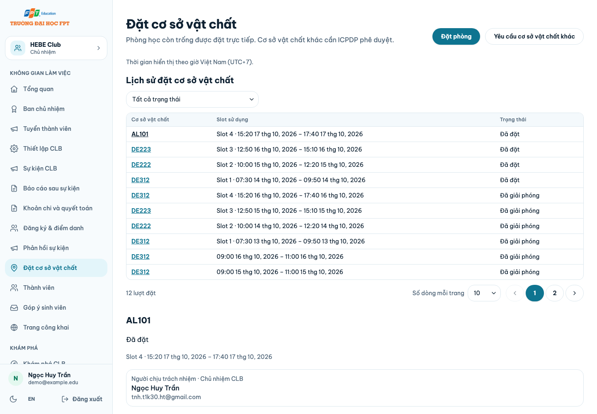

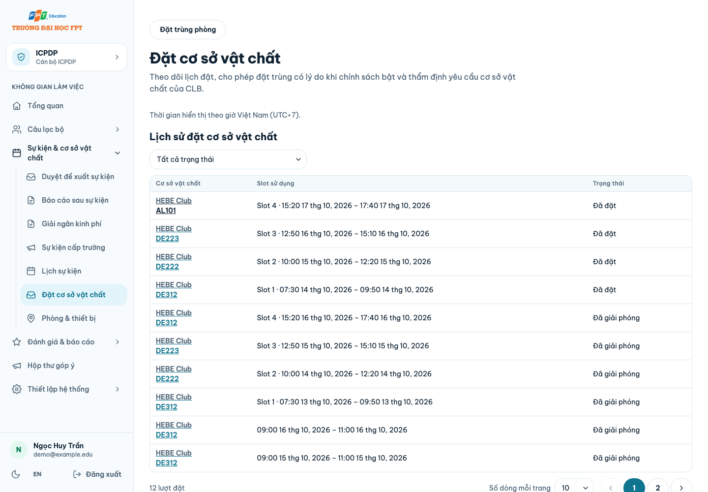

## 10. Nộp báo cáo sau sự kiện

**Vai trò:** CLB có `club.report.submit`. **Nơi bắt đầu:** **Báo cáo sau sự kiện**
(`/club/:clubId/event-reports`).

1. Chọn sự kiện đã kết thúc và đã chốt điểm danh.
2. Đọc số liệu nạp sẵn: đề xuất, điểm danh, ngân sách, khoản chi và phản hồi đủ ngưỡng.
3. Nhập kết quả thực tế, sự cố, bài học; thêm liên kết HTTPS tới minh chứng và ghi chú.
4. Chọn **Lưu bản nháp**. Nếu vừa sửa nội dung, lưu lại trước khi chọn **Nộp**.
5. Xác nhận nộp; kiểm tra trạng thái `Submitted` và số liệu snapshot đã đóng băng.
6. Nếu ICPDP trả sửa, đọc lý do, sửa nội dung/minh chứng, lưu và nộp lại. App tạo version
   mới; mở lịch sử để đối chiếu các bản cũ.

**Kết quả:** sự kiện sang `Report Submitted`, có task cho ICPDP. Nộp sau hạn vẫn được nhận
và đánh dấu trễ. Sự kiện nội bộ không ngân sách không có nghĩa vụ báo cáo ở màn này.

**Hiện trạng:** API báo cáo đã nối ở server chính nhưng cần policy POST_EVENT. Ảnh bên dưới
chụp từ database demo riêng có policy mẫu để minh hoạ đầy đủ.

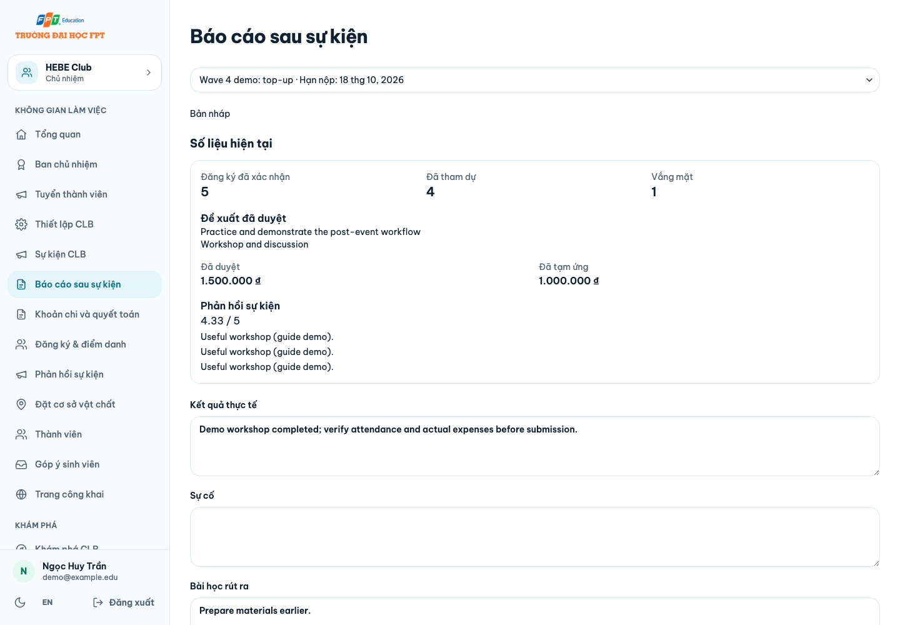

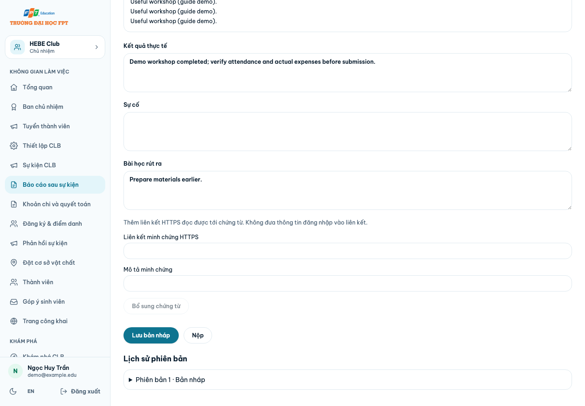

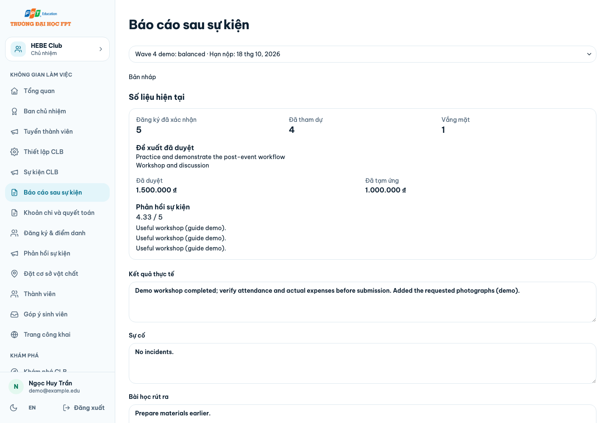

## 11. ICPDP thẩm định báo cáo

**Nơi bắt đầu:** **Báo cáo sau sự kiện** (`/workspace/event-reports`).

1. Chọn sự kiện chờ xét và nhận thẩm định.
2. Đối chiếu snapshot đã nộp với số liệu hiện tại, kế hoạch và điều kiện duyệt đề xuất.
3. Nhập lý do quyết định. Chọn **Chấp nhận** để đóng sự kiện hoặc **Trả về để sửa**.
4. Nếu có phát hiện, chọn mức độ, mở hồ sơ vi phạm rồi chấp nhận kèm liên kết hồ sơ.
   Đây là hai thao tác; kiểm tra hồ sơ đã tạo trước khi hoàn tất quyết định báo cáo.
5. Khi số liệu điểm danh mâu thuẫn, trả sửa để làm rõ; app chặn chấp nhận.

**Kết quả:** báo cáo Accepted → sự kiện Closed; báo cáo Returned for correction → sự kiện
Completed. Đóng sự kiện không tự tất toán ngân sách.

**Lưu ý hiện tại:** review phát hiện nhánh “hoàn toàn chưa nộp” có thể nhận báo cáo đã từng
nộp rồi bị trả sửa. Với trường hợp đó, kiểm tra lịch sử version và dùng nhánh yêu cầu sửa;
không ghi nhận như chưa từng nộp.

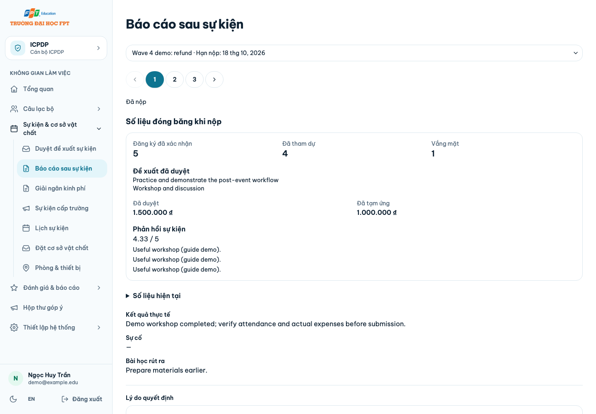

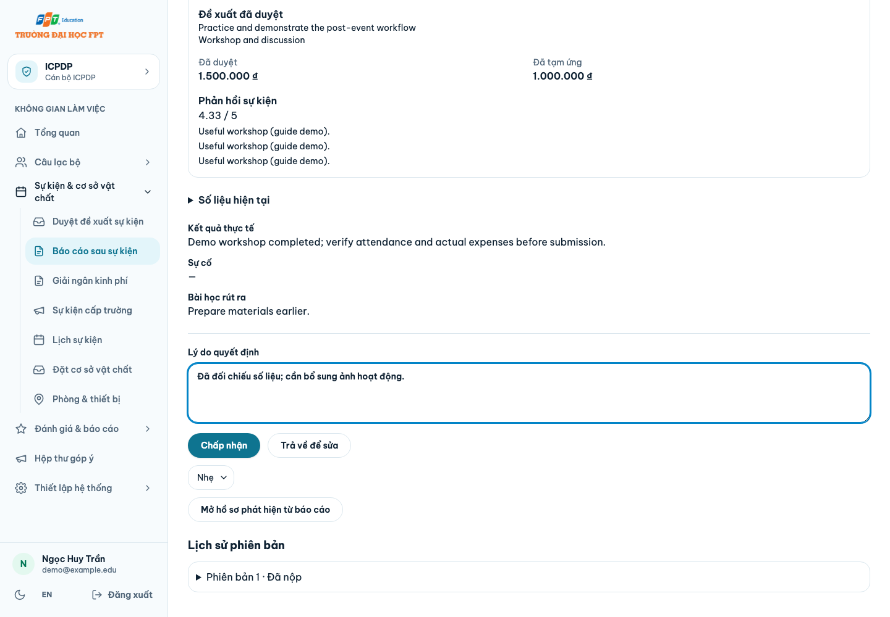

## 12. Ghi nhận tạm ứng

**Vai trò:** ICPDP. **Nơi bắt đầu:** **Giải ngân kinh phí** → chọn ngân sách
(`/workspace/budgets/:id`).

1. Kiểm tra sự kiện, hạng mục và tổng đã duyệt.
2. Nhập tiền tạm ứng, ngày chuyển, mã tham chiếu và ghi chú.
3. Chọn **Lưu**, đọc lại số tiền trên hộp xác nhận rồi xác nhận.
4. Kiểm tra dòng tiền trong lịch sử, tổng đã chuyển và hạn quyết toán.

**Kết quả:** ngân sách Approved → Disbursed ở lần ứng đầu. Có thể ứng nhiều lần trong giới
hạn đã duyệt; mỗi lần được ghi riêng. App chỉ ghi nhận dòng tiền, không chuyển tiền qua ngân hàng.

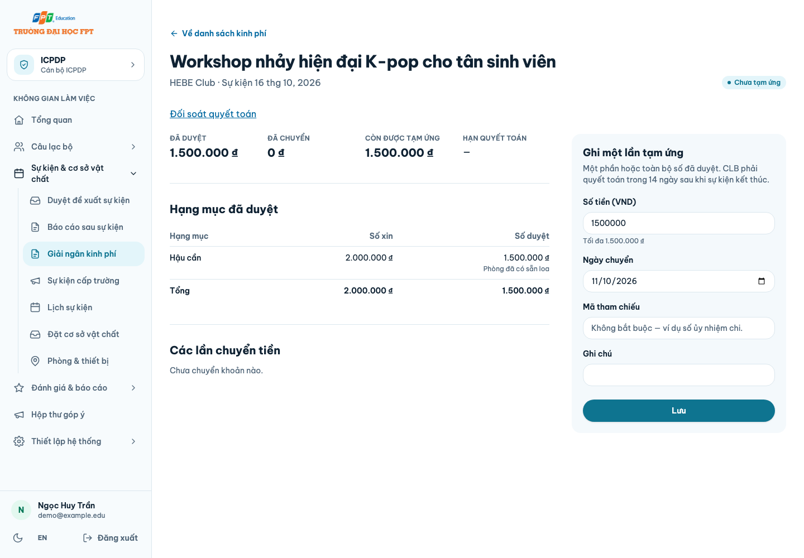

## 13. Khoản chi, chứng từ và nộp quyết toán

**Vai trò:** CLB có `club.expense.record`. **Nơi bắt đầu:** **Khoản chi và quyết toán**
(`/club/:clubId/budgets`). **Hiện trạng:** UC36/UC37 chờ bật API ở server chính; ảnh chạy API
thật trên database demo với quy định chứng từ mẫu.

1. Chọn ngân sách đang Disbursed hoặc Reconciliation Pending.
2. Chọn **Thêm khoản chi**, nhập hạng mục, số nguyên VND dương, ngày chi và mô tả; lưu.
3. Ở từng khoản chi, thêm loại chứng từ và liên kết HTTPS. Bộ demo dùng INVOICE, RECEIPT
   hoặc PROOF_OF_PAYMENT; bảng chứng từ bắt buộc theo hạng mục của bản chính còn chờ chốt BR25.
4. Kiểm tra khoản thiếu chứng từ, ngoài hạng mục hoặc vượt hạng mục đã duyệt.
5. Sau khi sự kiện kết thúc hoặc bị huỷ, kiểm tra tổng đã ứng, tổng chi, chi có/thiếu chứng
   từ và số dư. Chọn nộp quyết toán rồi xác nhận.
6. Nếu bị yêu cầu bổ sung, sửa khoản chi/thêm chứng từ rồi nộp lại từ Reconciliation Pending.

**Kết quả:** ngân sách sang Settlement Submitted; khoản chi bị khoá và tạo task thẩm định.
Khoản thiếu chứng từ có thể được ghi nhưng sẽ bị loại khi đối soát. Không thể nộp khi sự kiện
còn diễn ra hoặc hồ sơ đã được đối soát tất toán.

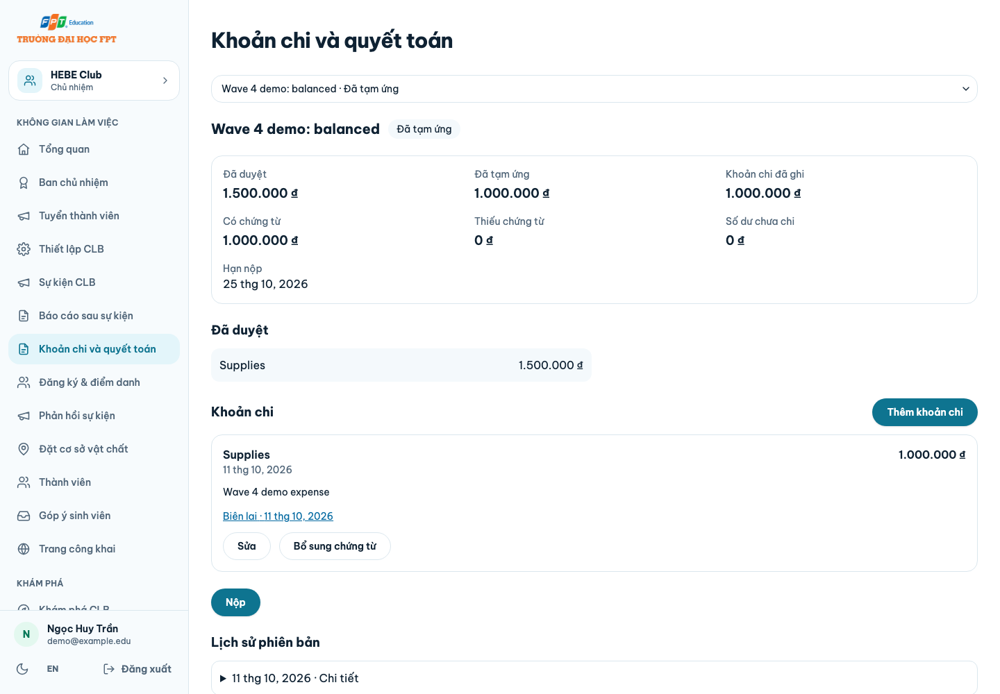

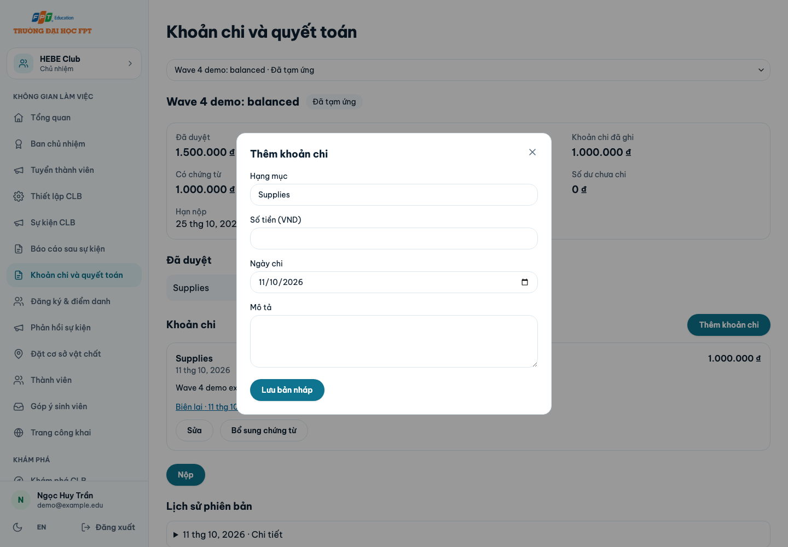

## 14. Đối soát, cấp bù và hoàn trả

**Vai trò:** ICPDP. **Nơi bắt đầu:** ngân sách → **Đối soát quyết toán**
(`/workspace/budgets/:id/reconciliation`). Đây là phần demo còn chờ kích hoạt ở server chính.

1. Nhận thẩm định bộ quyết toán. Đọc đủ các tổng: duyệt, tạm ứng, chi đã ghi, có chứng từ,
   thiếu chứng từ và số dư.
2. Chấp nhận hoặc loại **từng** khoản chi, luôn ghi lý do. Khoản thiếu chứng từ phải bị loại.
3. Nếu cần bổ sung, nhập lý do và trả về CLB; nếu đủ cơ sở, xác nhận chốt đối soát.
4. Kiểm tra chi hợp lệ và chênh lệch tất toán. Chi hợp lệ có trần là số đã duyệt.
5. Với chênh lệch dương, quay về **Giải ngân kinh phí**, ghi khoản TopUp đúng bằng chênh lệch.
6. Với chênh lệch âm, CLB hoàn tiền thực tế; officer ghi Refund. Có thể ghi nhiều lần nhưng
   không được vượt phần còn phải hoàn.
7. Chỉ kết thúc khi ngân sách Closed; theo dõi hạn hoàn và phần còn nợ trước đó.

| Chi hợp lệ − tạm ứng | Kết quả | Việc tiếp theo |
|---|---|---|
| Bằng 0 | Closed | Kiểm tra lịch sử đối soát |
| Lớn hơn 0 | Reconciled | Ghi cấp bù đúng chênh lệch, rồi Closed |
| Nhỏ hơn 0 | Recovery Pending | Ghi hoàn trả đủ phần phải hoàn, rồi Closed |

**Ví dụ seed:** tạm ứng 1.000.000 VND; chi hợp lệ 1.200.000 VND → cấp bù 200.000 VND.
Chi hợp lệ 800.000 VND → phải hoàn 200.000 VND. Bộ demo dùng hạn hoàn 14 ngày;
bản chính chờ xác nhận BR58.

**Luồng quá hạn:** officer có nhánh đối soát khi CLB chưa nộp. Review còn phát hiện lỗi
A2 có thể sinh cấp bù; chưa dùng nhánh này như quy trình đã nghiệm thu. Khi khoản hoàn
quá hạn, officer có thể mở hồ sơ FINANCIAL_EXCEPTION từ chính ngân sách.

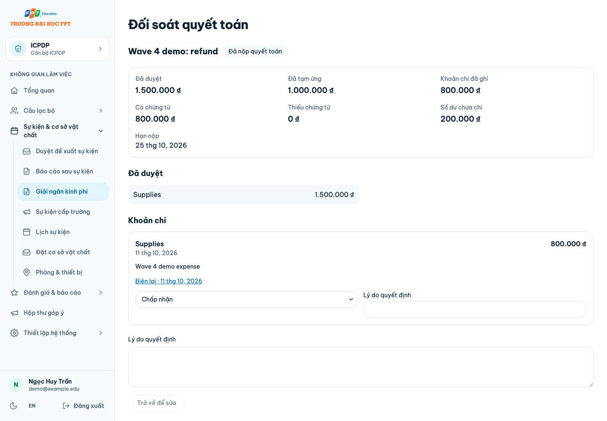

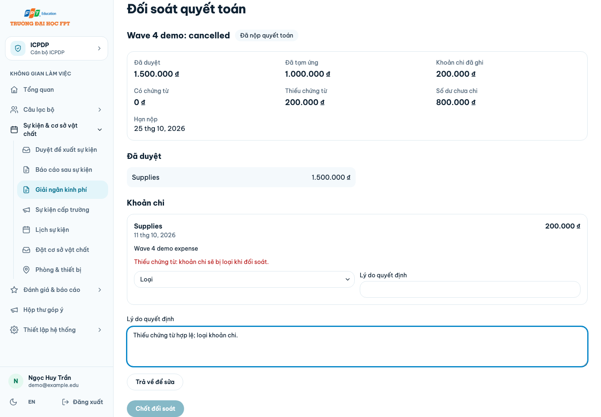

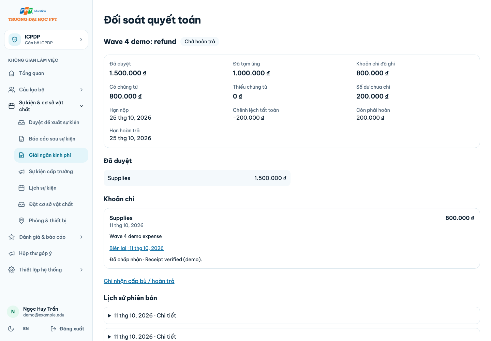

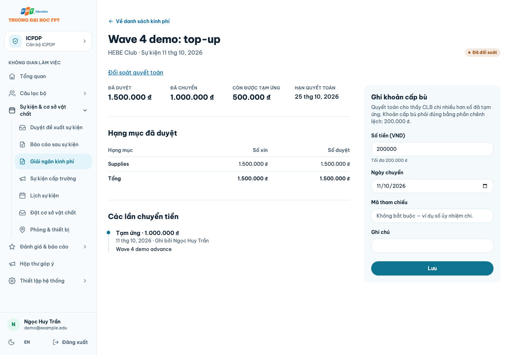

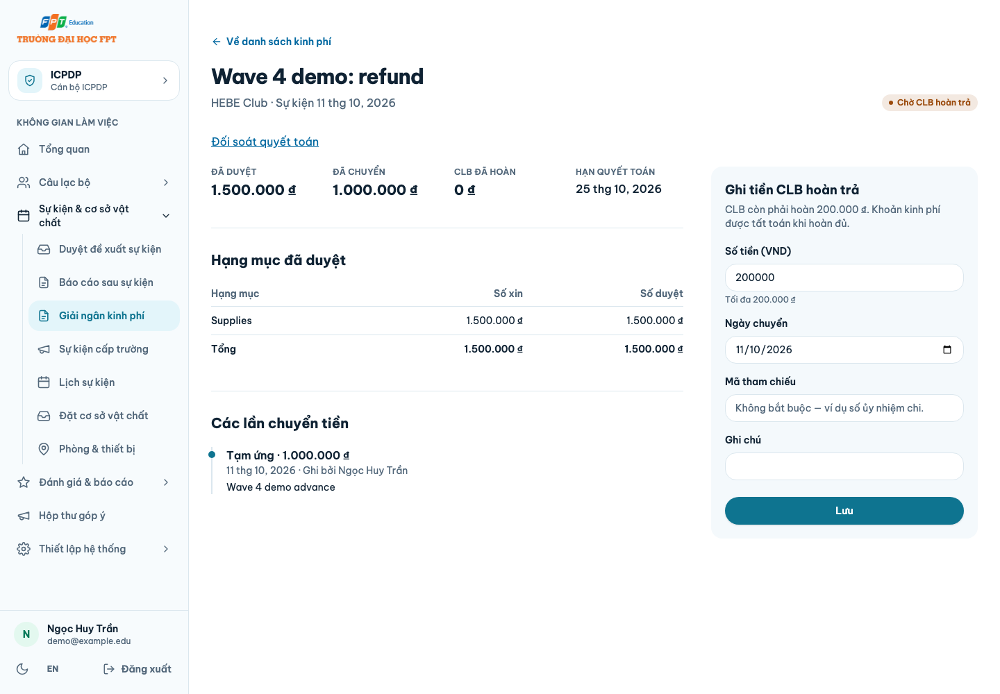

## 15. Tổng quan ICPDP và xử lý lỗi thường gặp

ICPDP mở `/icpdp` để theo dõi task, nghĩa vụ và số liệu tổng quan; đi vào từng hồ sơ để xử lý.
Các mục chính sách, phòng/thiết bị, đánh giá và xuất dữ liệu nằm trong thanh bên theo quyền.

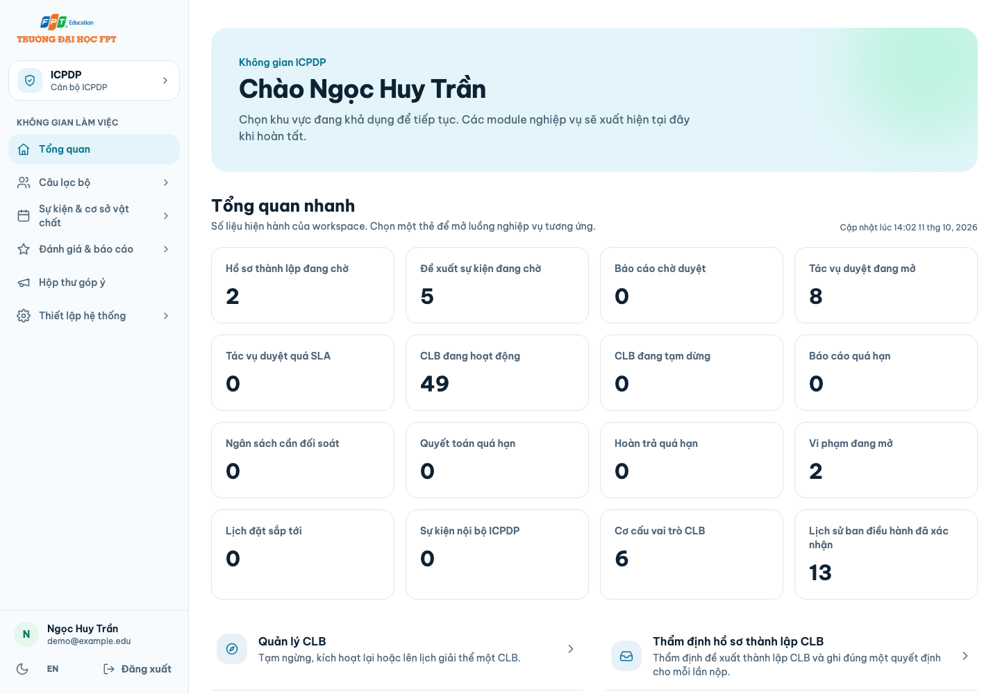

| Tình huống | Cách xử lý |
|---|---|
| Không thấy mục quản lý | Đổi đúng không gian; nhờ chủ nhiệm/cán bộ kiểm tra quyền |
| Phiên hết hạn | Đăng nhập lại, mở đúng hồ sơ và đọc trạng thái mới nhất |
| Hồ sơ đã thay đổi hoặc HTTP 409 | Tải lại, đối chiếu dữ liệu mới rồi thao tác lại |
| Báo cáo thiếu cấu hình hạn nộp hoặc HTTP 503 | ICPDP kiểm tra POST_EVENT và policy có hiệu lực tại thời điểm sự kiện kết thúc |
| Khoản chi bị khoá | Xem ngân sách đã nộp/đối soát; chờ nhánh trả bổ sung nếu cần sửa |
| Link minh chứng lỗi | Thay bằng liên kết HTTPS có quyền truy cập phù hợp trước khi nộp |
| Không thấy tổng hợp phản hồi | Kiểm tra số người phản hồi đã đạt ngưỡng policy chưa |
| Không thể hoàn/cấp bù số đã nhập | Đối chiếu khoản cấp bù chính xác hoặc phần còn phải hoàn |

## Phụ lục — Dữ liệu và nguồn ảnh

- Ảnh 01–04: dữ liệu công khai/API local; 05–13, 15–16, 23, 26–28: database nguồn sau seed.
- Ảnh 14, 17–22, 24–25, 29–32: API thật của bản demo, database `ucms_guide_demo`.
- Dữ liệu minh chứng `example.org` là placeholder demo. Khi sử dụng thực tế, thay bằng chứng
  từ/ảnh thật và kiểm tra người thẩm định mở được liên kết.
- Không copy phiên đăng nhập vào guide. Profile owner được che email ở thanh bên khi chụp;
  tên và email `@demo.ucms.edu.vn` là nhân vật mẫu.
- Chi tiết URL, nguồn dữ liệu và thao tác chụp ở `images/manifest.json`.
- Tình trạng wave 4 và lỗi còn mở: `../05-implementation/WAVE_4_REVIEW_2026-10-11.md`.

Tài liệu này hướng dẫn các luồng đã có màn hình. UC38/UC39 và các phần chưa nghiệm thu không
được coi là đã hoàn tất chỉ vì xuất hiện trong SRS hoặc thanh điều hướng.
